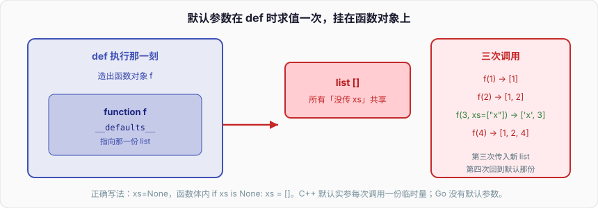
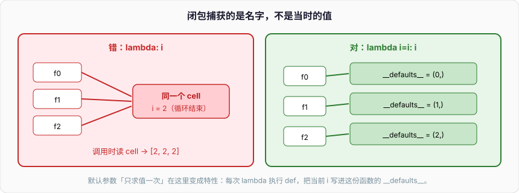

# 函数与作用域

```python
def f(a, items=[]):
    items.append(a)
    return items

print(f(1))
print(f(2))
print(f(3, items=["x"]))
print(f(4))
```

输出是 `[1]`、`[1, 2]`、`['x', 3]`、`[1, 2, 4]`。第三次传入了新 list，第四次又回到那个被 1 和 2 污染过的默认 list。

C++ 的默认参数也是在声明处写死，但那是「调用点把缺省值填进实参」，每次调用一份新的临时量（对 `vector` 这种会拷贝/移动）。Go 没有默认参数。Python 的默认值在 **`def` 语句执行时求值一次**，结果挂在函数对象的 `__defaults__` 上，之后所有「没传这个参数」的调用共享它。

函数不是一段待编译的文本，是运行时造出来的对象。作用域、闭包、装饰器、`lambda`，全部建立在这件事实上。



```python
print(f.__defaults__)          # ([1, 2, 4],)
print(f.__defaults__[0] is f(0))  # True，同一个 list
```

---

## 一、函数是一等对象

`def` 是可执行语句。跑到它时，解释器根据当前字节码创建一个 `function` 对象，再把名字绑到这个对象上。类里的 `def`、条件里的 `def`、函数里的 `def`，都是这个过程。

```python
def make_adder(n: int):
    def add(x: int) -> int:
        return x + n
    return add

add5 = make_adder(5)
print(add5(3), add5.__name__, callable(add5))
```

因为是对象，所以可以：

1. 赋值给别的名字
2. 当参数传（高阶函数）
3. 当返回值（闭包、装饰器）
4. 往上面挂属性
5. 放进 list / dict

```python
def ping() -> str:
    return "pong"

ping.method = "GET"                    # 函数属性，不是局部变量
ops = {"ping": ping, "n": lambda: 1}
print(ops["ping"](), ping.method)

alias = ping
print(alias is ping)
```

C++ 的函数不是对象，函数指针 / `std::function` / 函数对象才是。Go 的 `func` 是一等的，和 Python 更近，但 Go 函数没有随便挂属性这回事，也没有 `def` 在运行时创建。Python 甚至可以在 `if` 里定义两个同名函数，后执行到的覆盖先执行到的：

```python
debug = True

if debug:
    def log(msg: str) -> None:
        print("DEBUG", msg)
else:
    def log(msg: str) -> None:
        pass

log("boot")
```

这不是技巧，是「`def` 是语句」的直接推论。模块加载时顶层 `def` 全部执行一遍，所以模块级函数在 import 结束时已经存在。

函数对象上值得看的字段：

```python
def g(a: int, b: int = 1, *args, c: int = 2, **kwargs) -> int:
    """doc"""
    return a + b + c

print(g.__name__)
print(g.__doc__)
print(g.__defaults__)          # (1,)  仅位置或位置或关键字的默认值
print(g.__kwdefaults__)        # {'c': 2}  仅关键字的默认值
print(g.__code__.co_varnames)
print(g.__code__.co_argcount)
print(g.__annotations__)
```

`__code__` 是字节码对象，只读。改默认值可以写 `__defaults__`（不要在生产里玩），这正好解释为什么默认 list 能被后续调用改掉——它就是那个 tuple 里的对象。

---

## 二、参数：位置、关键字、`/`、`*`、`*args`、`**kwargs`

### 1、五种形态和顺序

签名从左到右只能按这个顺序（PEP 570 / 3102）：

```python
def f(pos_only, /, pos_or_kw, *args, kw_only, **kwargs):
    ...
```

- `/` 前面：仅位置，调用时不能写名字
- `/` 与 `*` 之间：位置或关键字
- `*` 后面、`**` 前面：仅关键字，调用时必须写名字
- `*args`：收多余位置参数成 tuple
- `**kwargs`：收多余关键字成 dict（3.7+ 插入有序）

```python
def connect(
    host: str,
    port: int = 8080,
    /,
    timeout: float = 3.0,
    *,
    tls: bool = True,
    **opts: object,
) -> None:
    print(host, port, timeout, tls, opts)

connect("127.0.0.1", 443)
connect("127.0.0.1", 443, timeout=1.0, tls=False, retry=2)
# connect(host="127.0.0.1")          # TypeError，host 仅位置
# connect("127.0.0.1", tls=False, timeout=1)  # 可以，timeout 是 pos_or_kw
# connect("127.0.0.1", 443, False)   # TypeError，tls 仅关键字，不能靠位置塞
```

`/` 的实际用途：参数名不想进入公开 API（名字以后要改、或和 `**kwargs` 冲突）、以及 C 扩展里本来就没有名字的参数。`len(obj)` 不能 `len(obj=x)`，就是仅位置。自己写库时，容易被调用方当关键字依赖的名字不要放 `/` 前面，除非你有把握永远不改。

`*` 仅关键字的用途更日常：布尔开关、可选语义参数，避免 `f(1, True, False)` 这种读不懂的位置调用。

```python
def copy_file(src: str, dst: str, *, overwrite: bool = False) -> None:
    print(src, dst, overwrite)

copy_file("/a", "/b", overwrite=True)
```

Go 没有默认参数也没有关键字参数，常用 option struct / 函数式 Option。C++ 有默认参数但没有关键字参数（直到没有），调用方靠位置对齐，所以 C++ 里也常把 bool 包成枚举。Python 用 `*` 把这件事做成语法。

### 2、`*args` / `**kwargs` 与解包

```python
def wrap(*args, **kwargs):
    print(args, kwargs)

wrap(1, 2, x=3)
wrap(*(4, 5), **{"x": 6})
```

转发时保持签名透明，装饰器常用：

```python
from functools import wraps
from collections.abc import Callable
from typing import TypeVar

P = TypeVar("P")
R = TypeVar("R")

def traced(fn: Callable[..., R]) -> Callable[..., R]:
    @wraps(fn)
    def inner(*args: object, **kwargs: object) -> R:
        print("call", fn.__name__, args, kwargs)
        return fn(*args, **kwargs)
    return inner

@traced
def add(a: int, b: int) -> int:
    return a + b

print(add(1, b=2))
print(add.__name__)            # add，因为 wraps 把元数据拷过来了
```

没有 `wraps`，`inner.__name__` 是 `"inner"`，调试、日志、`inspect.signature` 全乱。

`kwargs` 的 key 必须是 `str`。`**` 展开两个 dict 有重复 key 会 `TypeError`（调用时），而 `{**a, **b}` 是后面覆盖前面，不抛。两边不对称，容易混。

```python
def h(a: int, b: int) -> None:
    print(a, b)

try:
    h(**{"a": 1}, **{"a": 2, "b": 3})
except TypeError as e:
    print("call", e)

print({**{"a": 1}, **{"a": 2, "b": 3}})
```

### 3、仅位置和 `**kwargs` 的名字冲突

没有 `/` 时，已经有名字的参数不能再出现在 kwargs 里：

```python
def f(x: int, **kwargs: object) -> None:
    print(x, kwargs)

f(1, y=2)
try:
    f(1, x=2)
except TypeError as e:
    print(e)
```

想既有 `x` 又允许 kwargs 里出现 `"x"`（例如把 HTTP 查询参数原样转发），把 `x` 放到 `/` 前面：

```python
def f(x: int, /, **kwargs: object) -> None:
    print(x, kwargs)

f(1, x=2)                      # kwargs['x'] == 2，和位置 x 互不抢
```

这是 `/` 除「隐藏名字」之外的第二个硬需求。

---

## 三、默认参数只求值一次

再把开篇钉死。

```python
import time

def stamp(ts: float = time.time()) -> float:
    return ts

print(stamp())
time.sleep(0.01)
print(stamp())                 # 同一个时间戳，不是「每次调用现在」
print(stamp.__defaults__)
```

`time.time()` 在 def 时跑了一次。想每次取当前时间，默认值用 `None`：

```python
def stamp(ts: float | None = None) -> float:
    if ts is None:
        ts = time.time()
    return ts
```

可变对象同理。`dict`、`set`、自定义实例都不能当默认值，除非你明确要「跨调用共享」——那是单例缓存，应该写到模块级或 `functools.lru_cache`，不要藏在 `__defaults__` 里。

dataclass 的 `field(default_factory=list)`、pydantic 的 `Field(default_factory=list)` 解决的是同一件事：延迟到实例化才构造。函数这边没有 factory 语法，约定就是 `None`。

面试追问：「为什么设计成只求值一次？」

因为默认值要进函数对象，函数对象在 def 时创建。如果每次调用再求值，`def` 的右端就得保存成表达式 AST / 延迟 thunk，调用成本更高，也和「默认值是对象」的模型不一致。早期设计选了简单模型，于是有了这个永恒陷阱。

查看、修补（仅演示）：

```python
def acc(x, xs=[]):
    xs.append(x)
    return xs

acc(1)
acc.__defaults__ = ([],)       # 换一个空 list
print(acc(2))                  # [2]
```

能改 `__defaults__` 说明它就是普通对象图的一部分。别在业务里靠这个「重置」。

---

## 四、LEGB、global、nonlocal

### 1、四层查找

一个名字在函数里出现，CPython 按 LEGB 找：

1. **L**ocal：当前函数的局部（包括参数）
2. **E**nclosing：外层函数的闭包单元
3. **G**lobal：当前模块的全局
4. **B**uiltin：`builtins` 模块（`len`、`range`、`None`……）

找不到就 `NameError`。赋值默认绑到 Local——这是和「查找」不对称的地方，也是最多坑的来源。

```python
x = "global"

def outer() -> None:
    x = "enclosing"

    def inner() -> None:
        print(x)               # enclosing，闭包读

    inner()

outer()
print(x)
```

函数里对名字**赋值**，这个名字在整个函数作用域都是局部的，包括赋值之前：

```python
x = 1

def f() -> None:
    print(x)                   # UnboundLocalError，不是打印 1
    x = 2

try:
    f()
except UnboundLocalError as e:
    print(type(e).__name__, e)
```

编译期扫描到 `x = 2`，就把 `x` 标成本地变量。`print(x)` 发生在绑值之前，于是 UnboundLocalError。C++ / Go 没有「整函数作用域」，块级作用域下这句会去找外层的 `x`。Python 的函数是一个作用域（推导式除外），没有块级作用域：

```python
def g() -> None:
    if True:
        y = 1
    print(y)                   # 1，if 不是作用域

g()
```

`for` 的循环变量也漏到函数里，入门篇写过。`try/except` 的 `as e` 在 3.x 结束 except 块后会删掉 `e`（为了断开 traceback 循环引用），这是少数例外。

### 2、global

在函数里给模块级名字赋值，必须声明 `global`，否则你写的是局部：

```python
counter = 0

def bump_wrong() -> None:
    # counter += 1             # UnboundLocalError：有赋值，被当成局部
    pass

def bump() -> None:
    global counter
    counter += 1

bump()
print(counter)
```

读全局不需要 `global`。`global` 只影响赋值和 `del`。多个名字 `global a, b`。

后端里模块级可变全局基本都是隐患（并发、测试污染、隐式依赖）。配置用参数传入，状态放对象上。`global` 出现在业务函数里，当作 review 红旗。

### 3、nonlocal

改**最近一层** enclosing 作用域的变量，不用 global（那会跳到模块）。闭包计数器：

```python
def make_counter(start: int = 0):
    n = start

    def inc() -> int:
        nonlocal n
        n += 1
        return n

    def dec() -> int:
        nonlocal n
        n -= 1
        return n

    return inc, dec

inc, dec = make_counter(10)
print(inc(), inc(), dec())     # 11 12 11
```

没有 `nonlocal`，`n += 1` 会把 `n` 变成 inner 的局部，UnboundLocalError。`nonlocal` 找不到 enclosing 会 `SyntaxError`，不会退化为 global。

C++ 的 lambda `[&n]` 捕获引用、Go 的闭包直接捕获外层变量（循环变量坑 Go 1.22 才修），都比 Python 要「写了赋值就自动改外层」更直观。Python 强制你声明，是因为赋值默认造局部——语言把「引入新名字」和「更新旧名字」用同一个 `=`，只能靠关键字消歧义。

`global` 和 `nonlocal` 都是编译期声明，必须出现在使用之前，不能 `if` 里有条件地声明一半。

---

## 五、闭包延迟绑定：循环里套 lambda

经典坑：

```python
funcs = []
for i in range(3):
    funcs.append(lambda: i)

print([f() for f in funcs])    # [2, 2, 2]，不是 [0, 1, 2]
```

闭包捕获的是**名字**，不是当时的值。三个 lambda 的 `__closure__` 指向同一个 cell，cell 里的 `i` 在循环结束时是 2。调用时才去读 cell，所以全是 2。



Go 1.21 及更早的 `for i := range` 同一个坑；C++ 的 `[&i]` 也是。修复手法在 Python 里几乎总是「用默认参数把当前值绑进函数对象」：

```python
funcs = []
for i in range(3):
    funcs.append(lambda i=i: i)   # 默认参数在 def 时求值，i=0、1、2 各存一份

print([f() for f in funcs])    # [0, 1, 2]
```

这里默认参数的「只求值一次」反而成了特性：每次 `lambda i=i` 执行 def，把当前 `i` 的值写进这份 lambda 的 `__defaults__`。int 不可变，三份默认值互不影响。

等价的显式闭包：

```python
def bind(i: int):
    return lambda: i           # 每次 bind 调用造新 cell，i 是 bind 的局部

funcs = [bind(i) for i in range(3)]
print([f() for f in funcs])
```

`functools.partial` 也能绑：

```python
from functools import partial

def identity(x: int) -> int:
    return x

funcs = [partial(identity, i) for i in range(3)]
print([f() for f in funcs])
```

延迟绑定不只 lambda，普通 `def` 一样：

```python
def make() -> list:
    out = []
    for i in range(3):
        def f():
            return i
        out.append(f)
    return out

print([fn() for fn in make()])  # [2, 2, 2]
```

规则：**闭包读的是变量，不是快照。** 要快照，用默认参数、用 `partial`、用一层工厂函数。

列表推导里的 `i` 在 3.x 是独立作用域，但下面这样仍然共享：

```python
# 推导式的 i 不会泄漏，但 lambda 还是绑到 enclosing 的同一个 i
fs = [lambda: i for i in range(3)]
print([f() for f in fs])       # 仍是 [2,2,2]
```

推导式的迭代变量对闭包来说就是 enclosing 里的一个 cell（3.12 行为以你本机为准，CPython 对推导式有独立 frame，但循环结束 cell 仍停在最后值）。默认参数修法同样适用：`[lambda i=i: i for i in range(3)]`。

---

## 六、闭包与 cell，`__closure__`

闭包变量存在 `cell` 对象里。外层函数的局部如果被内层引用，编译器不会把它当普通局部（存在 frame 的 fastlocals 数组里就结束），而是放到 cell，内外通过 `LOAD_DEREF` / `STORE_DEREF` 访问。外层返回之后 frame 没了，cell 还活着，所以闭包能读到「已经返回的函数的局部」。

```python
def outer(n: int):
    def inner(x: int) -> int:
        return x + n
    print("cell", inner.__closure__)
    print("cell contents", inner.__closure__[0].cell_contents)
    print("freevars", inner.__code__.co_freevars)
    print("outer cellvars", outer.__code__.co_cellvars)
    return inner

f = outer(10)
print(f(1))
print(f.__closure__[0].cell_contents)
f.__closure__[0].cell_contents = 100   # 能改，演示用
print(f(1))
```

`__closure__` 是 cell 的 tuple，顺序和 `co_freevars` 一致。没有自由变量就是 `None`。

多个内层函数共享同一 cell：

```python
def pair():
    n = 0

    def inc():
        nonlocal n
        n += 1
        return n

    def get():
        return n

    return inc, get

inc, get = pair()
inc()
inc()
print(get())                   # 2
print(inc.__closure__[0] is get.__closure__[0])  # True
```

这就是为什么 `inc` 能改、`get` 能读——不是拷了两份 `n`。对应 Go 闭包捕获同一变量、C++ lambda 捕获同一引用。Python 把这层实现暴露成 `cell_contents`，调试延迟绑定时直接看它。

面试问「闭包会不会让变量活更久」：会。cell 持有对象引用，外层函数返回后对象不释放。大对象被闭包无意捕获（比如把整个 request 关进回调）是内存泄漏的一种，和循环引用不同，GC 帮不上忙——引用链是活的。

```python
def handler_factory(buf: bytearray):
    def handle() -> int:
        return len(buf)        # 整个 buf 被 cell 抓住
    return handle

h = handler_factory(bytearray(10_000_000))
# buf 的名字没了，对象还在，直到 h 被丢掉
```

---

## 七、lambda：能做什么不能做什么

`lambda` 是表达式形态的函数定义，只能写**一条表达式**当返回值，不能写语句（`=` 赋值、`for`、`while`、`return`、`def`、`raise` 作为语句）。

```python
add = lambda x, y: x + y
print(add(1, 2), add.__name__)  # <lambda>
```

能：当 `key=`、一次性回调、和 `partial` 组合。  
不能：注解（3.11 仍不能给 lambda 参数写完整注解的舒适语法）、多语句、文档字符串、容易读的名字。

```python
xs = [("b", 2), ("a", 1), ("c", 3)]
print(sorted(xs, key=lambda p: p[1]))
print(sorted(xs, key=lambda p: (-p[1], p[0])))
```

超过一行逻辑就 `def`。lambda 里再套 lambda、再写海象，review 直接打回。

条件表达式可以：

```python
abs1 = lambda x: x if x >= 0 else -x
print(abs1(-3))
```

不能直接 `lambda x: ys.append(x)` 当「过程」用——等一下，`append` 是表达式，返回 `None`，能写，但那是在推导式/map 里塞副作用，别这么干。

默认参数、`*args **kwargs`、仅关键字，lambda 都支持：

```python
f = lambda *xs, sep=",": sep.join(map(str, xs))
print(f(1, 2, 3, sep="-"))
```

捕获规则和 `def` 完全一样，延迟绑定同样存在。`lambda` 不是「另一种闭包」，只是语法短。

C++ 的 lambda 能写函数体、能指定捕获列表 `[=]` `[&]` `[i]`，表达力强得多。Go 的匿名 `func` 也是完整函数。Python 的 lambda 故意做弱，逼你把非平凡函数写成 `def`——这是风格选择，不是缺陷。

---

## 八、functools：partial、lru_cache、reduce、cmp_to_key

`functools` 是函数对象的工具箱。四个最常用的。

### 1、partial：冻一部分参数

```python
from functools import partial
import json

dumps = partial(json.dumps, ensure_ascii=False, separators=(",", ":"))
print(dumps({"n": "中"}))

def power(base: int, exp: int) -> int:
    return base ** exp

square = partial(power, exp=2)
print(square(5))
```

`partial` 对象不是裸 function，`isinstance(square, type(power))` 为 False。它可调用、有 `func` / `args` / `keywords` 属性。`inspect.signature` 能展开它。装饰器里如果要保留原函数身份，用 `wraps`；只是绑参数，用 `partial`。

和 lambda 比：`partial(power, exp=2)` 不引入延迟绑定问题，意图更清楚。能 `partial` 就别写 `lambda x: power(x, 2)`。

注意位置参数冻结在左边：`partial(f, 1)(2)` 等于 `f(1, 2)`。想冻右边，用关键字。

### 2、lru_cache：函数级 LRU

```python
from functools import lru_cache

@lru_cache(maxsize=128)
def fib(n: int) -> int:
    if n < 2:
        return n
    return fib(n - 1) + fib(n - 2)

print(fib(30), fib.cache_info())
fib.cache_clear()
```

`maxsize=None` 变成无界缓存（`functools.cache` 是 3.9+ 的别名）。key 是参数的哈希，所以**所有参数必须可哈希**——list / dict 当参数会 `TypeError`。

```python
@lru_cache(maxsize=32)
def parse(path: str, flags: tuple[str, ...] = ()) -> str:
    return path + "|" + ",".join(flags)

print(parse("/tmp", ("a",)))
# parse("/tmp", ["a"])         # TypeError: unhashable type: 'list'
```

缓存是进程内、按函数对象存的。方法上用 `lru_cache` 会把 `self` 算进 key，实例永远不释放（缓存持有 self）。实例方法缓存用 `cached_property`（3.8+）或自己写带弱引用的缓存。面向对象篇会再提。

```python
from functools import cached_property

class Page:
    def __init__(self, n: int) -> None:
        self.n = n

    @cached_property
    def heavy(self) -> int:
        print("compute")
        return self.n * 2

p = Page(3)
print(p.heavy, p.heavy)        # 只打印一次 compute
```

并发：`lru_cache` 在 3.9+ 对命中路径有锁，不要假设复杂副作用函数塞进去就线程安全。纯函数才适合 cache。

### 3、reduce

```python
from functools import reduce
from operator import mul, add

print(reduce(add, [1, 2, 3, 4], 0))
print(reduce(mul, range(1, 6), 1))     # 5!
```

没有初始值时，空序列抛 `TypeError`。多数时候 `sum` / `any` / `all` / `"".join` / 循环更可读。`reduce` 适合已经有现成二元函数、或写函数式管道。Python 故意把它从 builtin 踢到 functools，就是不鼓励当默认工具。

### 4、cmp_to_key

3.x 的 `sort` 没有 `cmp`，只有 `key`。老代码或「比两个元素」的逻辑用 `cmp_to_key` 包一层：

```python
from functools import cmp_to_key

def cmp_rev(a: int, b: int) -> int:
    return (a < b) - (a > b)   # 反向，等价 b-a 但防溢出（int 无溢出，习惯而已）

print(sorted([3, 1, 2], key=cmp_to_key(cmp_rev)))
```

`key` 能表达的（按字段、按长度）不要用 `cmp`。`cmp` 是 O(n log n) 次比较；`key` 是 O(n) 次变换再比变换结果，通常更快。只有比较关系不能表达成「每个元素一个指标」时才 `cmp_to_key`，例如图节点的拓扑约束比较。

其它常用：`wraps`、`singledispatch`（按第一个参数类型分发）、`total_ordering`（给类补齐比较方法）。`singledispatch` 点到为止：它按类型分发，不是完整的多方法。

```python
from functools import singledispatch

@singledispatch
def dumps(obj: object) -> str:
    return str(obj)

@dumps.register
def _(obj: int) -> str:
    return f"i:{obj}"

@dumps.register(list)
def _(obj: list) -> str:
    return "[" + ",".join(dumps(x) for x in obj) + "]"

print(dumps(3), dumps([1, "a"]))
```

---

## 九、高阶函数：map / filter 和推导式怎么选

```python
print(list(map(str.upper, ["a", "b"])))
print(list(filter(None, [0, 1, "", "x", None])))  # None 当谓词：真值测试
```

`map`/`filter` 返回迭代器（3.x），惰性。推导式造 list/set/dict，生成器表达式 `(x for x in xs if ...)` 才是惰性对照物。

选择：

| 场景 | 用 |
| --- | --- |
| 已有具名函数，一对一变换，要惰性 | `map(fn, xs)` |
| 表达式变换，要 list | `[expr for x in xs]` |
| 过滤 + 变换 | 推导式一次写完，别 `map+filter` 套 |
| 谓词已有具名函数，只要惰性过滤 | `filter(pred, xs)` |
| 副作用 | `for` 循环，不用 map/推导式 |

```python
# 清楚
ids = [int(s) for s in raw if s.isdigit()]

# 等价但吵
ids = list(map(int, filter(str.isdigit, raw)))
```

`map` 能吃多个序列，像 zip 再喂函数：

```python
print(list(map(lambda x, y: x + y, [1, 2], [3, 4])))
```

两个序列不等长时，`map` 停在最短，和 `zip` 一样。这个场景推导式要 `zip`，不一定更短。

C++ 的 `std::transform` / `std::views::filter`、Go 1.23 的 `slices` 和 range-over-func，都在补这层。Python 推导式是语言级的，团队默认用推导式，`map`/`filter` 留给已经是函数对象的管道。

`bool` 当谓词：`filter(None, xs)` 丢掉假值。空字符串、0、空 list 都会被丢掉，和 `if x` 同一套真值规则。要过滤 `None` 但保留 0，写 `lambda x: x is not None` 或推导式。

---

## 十、递归与 sys.setrecursionlimit，没有尾递归

```python
import sys

print(sys.getrecursionlimit())  # 默认通常 1000

def rec(n: int) -> int:
    if n == 0:
        return 0
    return rec(n - 1) + 1

try:
    rec(2000)
except RecursionError as e:
    print(type(e).__name__)
```

CPython 用 C 栈承载 Python 栈帧，深度上限既是解释器的保护，也是硬限制。`sys.setrecursionlimit` 可以调大，但 C 栈溢出会直接段错误，解释器拦不住。生产里把 limit 调到几万是赌机器栈大小。

**没有尾递归优化。** 最后一句 `return rec(n-1)` 照样长一帧。CPython 明确拒绝 TCO：traceback 要完整，调试器要每帧都在。

```python
def fact(n: int, acc: int = 1) -> int:
    if n <= 1:
        return acc
    return fact(n - 1, acc * n)   # 尾调用，照样 RecursionError

try:
    fact(2000)
except RecursionError:
    print("no TCO")
```

深递归改循环或显式栈。DFS 用 `list` 当栈，BFS 用 `deque`。树深度由用户输入决定时（目录遍历、AST），递归深度等于树高，要当攻击面看。

```python
def fact_iter(n: int) -> int:
    acc = 1
    for i in range(2, n + 1):
        acc *= i
    return acc

print(fact_iter(10))
```

互递归、树形 DP 在 n 很小（AST 节点类型、状态机）时递归很合适。n 跟数据规模走，先想迭代。

`lru_cache` 加递归是记忆化，能把指数变成线性，但**第一次展开仍然要 n 层栈**：

```python
from functools import lru_cache

@lru_cache(maxsize=None)
def fib(n: int) -> int:
    if n < 2:
        return n
    return fib(n - 1) + fib(n - 2)

print(fib(30))
# fib(2000)  第一次仍 RecursionError，缓存救不了深度
```

要大 n 的 fib，循环。记忆化解决的是重叠子问题，不是栈深度。

Go 的 goroutine 栈可增长，递归宽松得多，但仍不是无限。C++ 同样吃 C 栈，编译器可能 TCO，但不是标准保证。三门语言里 Python 对深递归最不友好，接受即可。

---

## 十一、typing.Callable 点到为止

注解一个「能调用的东西」：

```python
from collections.abc import Callable

def apply(fn: Callable[[int, int], int], a: int, b: int) -> int:
    return fn(a, b)

print(apply(lambda x, y: x + y, 1, 2))
```

`Callable[[Arg1, Arg2, ...], Return]`。参数列表只能是这一种位置形态，表达不了「仅关键字」「默认值」。需要精确签名用 `Protocol` 定义 `__call__`，或 3.10+ 的 `ParamSpec` / `Concatenate` 写装饰器：

```python
from collections.abc import Callable
from typing import ParamSpec, TypeVar

P = ParamSpec("P")
R = TypeVar("R")

def traced(fn: Callable[P, R]) -> Callable[P, R]:
    def inner(*args: P.args, **kwargs: P.kwargs) -> R:
        return fn(*args, **kwargs)
    return inner
```

细节留给类型注解篇。现在够用的是：给回调写 `Callable[[int], None]`，不要写 `function`，不要写 `Any` 然后靠文档。`Callable[..., R]` 表示参数随意。

运行时 `Callable` 是 ABC，`isinstance(fn, Callable)` 等价 `callable(fn)`，对对象的 `__call__` 也成立。注解里用 `collections.abc.Callable`，3.9 以前从 `typing` 引。

---

## 十二、和 C++ / Go 的函数心智

| 维度 | C++ | Go | Python |
| --- | --- | --- | --- |
| 函数是不是对象 | 不是，指针/function 才是 | 是 | 是，还能挂属性 |
| 默认参数 | 声明处，每次调用填入 | 无，用 Option | def 时求值一次，共享 |
| 关键字参数 | 无 | 无 | 有，`*` 强制 |
| 仅位置 | 天然全是 | 天然全是 | `/` 标出来 |
| 可变参数 | `initializer_list` / 模板 | `...T` | `*args **kwargs` |
| 作用域 | 块级 | 块级 | 函数级（推导式独立） |
| 闭包捕获 | 捕获列表 | 引用捕获，1.22 循环每次新变量 | 捕获名字（cell），延迟绑定 |
| 尾递归 | 编译器可能优化 | 不保证 | 明确没有 |
| 错误 | 异常或返回值 | `(T, error)` | 异常；多返回值是 tuple |
| 匿名函数 | 完整 lambda | 完整 `func` | 单表达式 lambda |
| 重载 | 有 | 无 | 无，靠默认参数 / `singledispatch` |

Go 的 `defer` 捕获循环变量曾经是同一类延迟绑定。Python 没有 defer，但 `funcs.append(lambda: i)` 就是那件事。修法都是「当时求值，绑到新存储」。

C++ 默认参数如果写成 `void f(std::vector<int> v = {});`，每次调用一个新 vector，看起来「没这个坑」。但 `void f(std::vector<int>* p = &GLOBAL);` 立刻有共享。Python 把对象引用当默认语义，坑是默认的，不是特例。

---

## 十三、装饰器最小模型（为闭包收个尾）

装饰器就是「接受函数、返回函数」的语法糖：

```python
def deco(fn):
    def inner(*args, **kwargs):
        return fn(*args, **kwargs)
    return inner

@deco
def h() -> int:
    return 1
# 等价于 h = deco(h)
```

带参数的装饰器是三层：外层收装饰器参数，中层收函数，内层收调用参数。本质全是闭包。

```python
from functools import wraps

def repeat(n: int):
    def deco(fn):
        @wraps(fn)
        def inner(*args, **kwargs):
            last = None
            for _ in range(n):
                last = fn(*args, **kwargs)
            return last
        return inner
    return deco

@repeat(3)
def tick() -> str:
    print("tick")
    return "ok"

print(tick())
```

`@repeat(3)` 先调用 `repeat(3)` 得到 `deco`，再 `tick = deco(tick)`。默认参数陷阱在这里也会出现：装饰器如果把可变对象关进闭包当缓存，所有被装饰函数可能共享——用 factory，或把缓存挂在 `inner` 的属性上。

```python
def memo(fn):
    cache = {}                 # 每个 deco 调用一份，正确

    @wraps(fn)
    def inner(x):
        if x not in cache:
            cache[x] = fn(x)
        return cache[x]
    inner.cache = cache
    return inner
```

如果写成 `def memo(fn, cache={})`，所有 `memo` 共享缓存，跨函数串味。又是开篇那个 list，换了一身衣服。

---

## 十四、几个审查会拦的具体问题

### 1、可变默认值

已经说了三遍。看到 `def f(..., xs=[], d={}, s=set())` 直接改 `None`。

### 2、闭包当回调绑循环变量

```python
buttons = []
for name in ["ok", "cancel"]:
    buttons.append(lambda name=name: print(name))
```

Web 框架里 `lambda: handle(item.id)` 放进路由表，同样要 `id=item.id` 或 `partial(handle, item.id)`。

### 3、用可变对象当 lru_cache 的 key

先把 list 转 tuple、dict 转 `tuple(sorted(d.items()))`，或不要 cache。

### 4、在 except 里定义函数并捕获 e

```python
handlers = []
try:
    ...
except Exception as e:
    def handle():
        print(e)               # 3.x except 结束 e 被删，可能 UnboundLocalError
    handlers.append(handle)
```

绑一下：`err = e`，闭包捕获 `err`。

### 5、`global` 改配置

把配置变成参数或对象。测试要打补丁时，全局让 `monkeypatch` 满天飞。

### 6、递归处理用户输入的树

限制深度，或改显式栈。`setrecursionlimit(10**6)` 不是解决方案。

---

## 十五、可运行：把坑跑一遍

```python
"""function_scope.py — 函数对象与作用域。Python 3.11+"""

from __future__ import annotations

from functools import lru_cache, partial, reduce, wraps
from operator import add


def mutable_default() -> None:
    def f(a, items=[]):
        items.append(a)
        return items

    print("default 1", f(1))
    print("default 2", f(2))
    print("default 3", f(3, ["x"]))
    print("default 4", f(4), "stored", f.__defaults__)


def late_binding() -> None:
    bad = [lambda: i for i in range(3)]
    good = [lambda i=i: i for i in range(3)]
    print("late", [f() for f in bad])
    print("bound", [f() for f in good])


def cells() -> None:
    def outer(n: int):
        def inner(x: int) -> int:
            return x + n
        return inner

    f = outer(10)
    assert f.__closure__ is not None
    print("cell", f.__closure__[0].cell_contents, f(1))


def param_order() -> None:
    def connect(host: str, /, port: int = 80, *, tls: bool = False) -> str:
        return f"{host}:{port} tls={tls}"

    print(connect("localhost"))
    print(connect("localhost", 443, tls=True))
    try:
        connect(host="localhost")
    except TypeError as e:
        print("pos-only", e)


def deco_wraps() -> None:
    def deco(fn):
        @wraps(fn)
        def inner(*args, **kwargs):
            return fn(*args, **kwargs)
        return inner

    @deco
    def add(a: int, b: int) -> int:
        return a + b

    print("name", add.__name__, add(1, 2))


@lru_cache(maxsize=None)
def fib(n: int) -> int:
    if n < 2:
        return n
    return fib(n - 1) + fib(n - 2)


def main() -> None:
    mutable_default()
    late_binding()
    cells()
    param_order()
    deco_wraps()
    print("fib(20)", fib(20), fib.cache_info())
    square = partial(pow, 2)
    print("partial", square(10))
    print("reduce", reduce(add, [1, 2, 3], 0))

    # UnboundLocalError
    x = 1

    def shadow() -> None:
        try:
            print(x)
            x = 2  # noqa: F841
        except UnboundLocalError as e:
            print("unbound", e)

    shadow()


if __name__ == "__main__":
    main()
```

跑完应对上这几件事：默认 list 跨调用增长；lambda 不绑默认就全是最后一轮；cell 里能读到外层的 `n`；`/` 拒绝关键字传入；`wraps` 保住名字；`lru_cache` 的 `hits` 在第二次开始涨。

函数对象在 `def` 那一行就活了，默认值、闭包 cell、装饰器包装，都是往这个对象上挂图。下一篇把同样的模型套到 class 上：`obj.method()` 其实是 `Class.method(obj)`，中间插入的那一层叫描述符。
