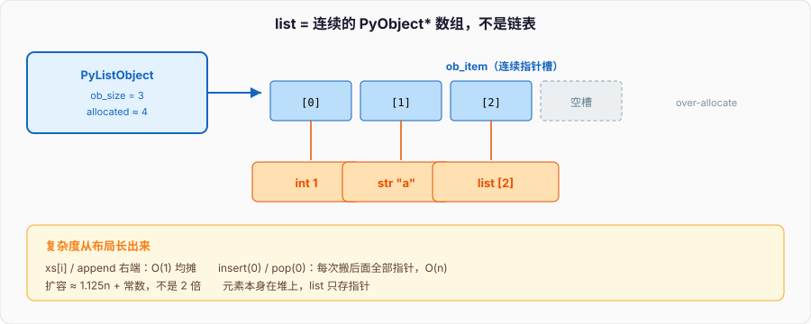
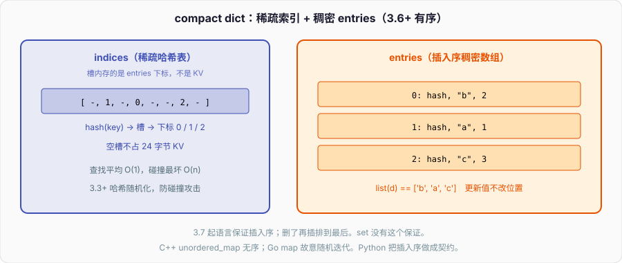
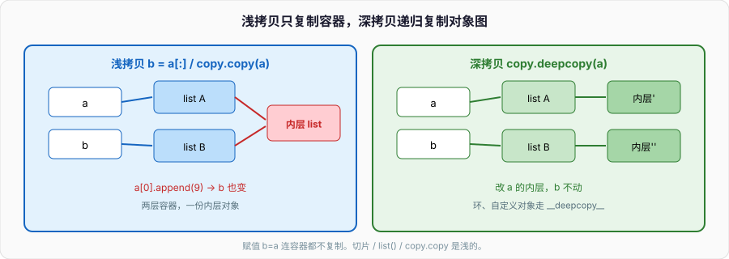

# 数据结构

线上有过一段同步逻辑，把下游返回的 id 攒成列表：

```python
ids: list[int] = []
for item in items:          # 10 万级
    ids += [item.id]        # 看起来无害
```

`+=` 对 list 是原地 `extend`，`[item.id]` 却每次分配一个临时单元素 list。改成 `ids.append(item.id)` 立刻少一截分配。更糟的是另一处把 list 当队列：

```python
q = list(range(100_000))
while q:
    x = q.pop(0)            # 每次搬后面全部元素
    ...
```

10 万次 `pop(0)` 是约 `n²/2` 次元素移动。换成 `collections.deque.popleft()` 变成 O(1)。容器选错，算法还没登场复杂度已经炸了。

C++ 里 `vector` / `deque` / `list` / `unordered_map` 是不同的类型，选错编译器不会帮你改，但至少名字提醒你。Go 的 `slice` 和 `map` 更少，queue 得自己用 slice 头尾下标或容器库。Python 的 `list` 太能装——栈、队列、数组、动态缓冲都有人拿它顶，于是性能和正确性问题都从「默认用 list」长出来。

---

## 一、list：连续数组 + over-allocate

### 1、它不是链表

CPython 的 `list` 是 `vector<PyObject*>`：一块连续内存，里面存的是指向对象的指针，不是对象本身。所以 `list[int]` 和 `list[str]` 运行时是同一种对象，异构完全合法：

```python
xs: list[object] = [1, "a", [2]]
print(len(xs), xs[0], xs[-1])
```

连续指针数组带来的复杂度：

| 操作 | 均摊 / 最坏 |
| --- | --- |
| `xs[i]`、`xs[i] = v` | O(1) |
| `append` / `pop()`（右端） | 均摊 O(1) |
| `insert(0, x)` / `pop(0)` | O(n) |
| `insert(i, x)` | O(n-i) |
| `x in xs` | O(n) 扫描 |
| `xs[a:b]` | O(b-a) 新 list |

和 `std::vector` 一致，和 `std::list`、Go 的 `container/list` 完全不是一类东西。C++ 面试常问 vector 扩容，Python 同样有。



### 2、over-allocate 与均摊 O(1)

`append` 满了要扩容。CPython 的策略不是简单倍增，公式在 `list_resize`（`Objects/listobject.c`）：

```text
new_allocated = newsize + (newsize >> 3) + (newsize < 9 ? 3 : 6)
```

大约是 `1.125 * n` 再加一个小常数。比 `vector` 常见的 1.5/2 倍更抠内存，扩容更勤。

```python
import sys

xs: list[int] = []
last = 0
for i in range(40):
    xs.append(i)
    size = sys.getsizeof(xs)
    if size != last:
        print(f"len={len(xs):2d}  nbytes={size}  slots≈{(size - 56) // 8}")
        last = size
```

64 位 CPython 3.12 上 list 对象头约 56 字节，每个槽 8 字节指针。你会看到容量按 0, 4, 8, 16, 25, 35... 这种台阶跳，不是 2 的幂。

`append` 均摊 O(1) 的前提是：扩容拷贝指针的成本摊到多次 append 上。如果你先知道长度，`xs = [0] * n` 或 `xs = [None] * n` 一次分配到位，避免反复扩容：

```python
n = 10_000
xs = [0] * n          # 一个 list，n 个槽指向同一个 int 0（小整数 intern）
ys = [[0] * 3 for _ in range(n)]   # n 个独立的 [0,0,0]
```

`[0]*n` 对不可变元素是对的；对可变元素是共享引用，见第六节。

### 3、`+=`、`extend`、`append`、`+`

```python
a = [1, 2]
a.append(3)          # 原地，加一个元素
a.extend([4, 5])     # 原地，加一串
a += [6]             # 对 list 等价于 extend，原地
b = a + [7]          # 新 list，a 不动
print(a, b)
```

`a += [x]` 是原地，所以：

```python
def add(xs: list[int]) -> None:
    xs += [1]

a = [0]
add(a)
print(a)             # [0, 1]
```

但 `+=` 右边如果是生成器，list 会迭代它；如果写成 `xs = xs + [1]`，那是新对象，函数里换绑局部名，外面看不到。`+=` 和 `+` 对可变序列语义不同，这是审查里的常客。

循环里 `ids += [item.id]` 每次造临时 list，改 `append`。循环里 `ids = ids + [item.id]` 每次拷贝整个前缀，平方复杂度，比前者更糟。

### 4、`pop(0)` / `insert(0)` 为什么 O(n)

底层是 `memmove` 把后面的指针整体挪一位。n=1e5 时一次 `pop(0)` 搬约 1e5 个指针；循环做 n 次就是 n²。

```python
import time
from collections import deque

N = 80_000

lst = list(range(N))
t0 = time.perf_counter()
while lst:
    lst.pop(0)
print("list.pop(0):", time.perf_counter() - t0)

dq = deque(range(N))
t0 = time.perf_counter()
while dq:
    dq.popleft()
print("deque.popleft:", time.perf_counter() - t0)
```

量级差几十到上百倍。队列、BFS、滑动窗口的左端弹出，用 `deque`。栈用 list 的 `append`/`pop()` 是对的，右端 O(1)。

### 5、切片是浅拷贝

```python
a = [[1], [2], [3]]
b = a[:]              # 新 list，里面的指针还指向原来的内层 list
b[0].append(99)
print(a)              # [[1, 99], [2], [3]]
print(a is b, a[0] is b[0])  # False True
```

`a[:]`、`list(a)`、`copy.copy(a)` 都是浅拷贝：只复制一层指针。`a[1:3]` 同样是新 list + 共享元素。

切片赋值是原地改长度：

```python
xs = [0, 1, 2, 3, 4]
xs[1:4] = [9, 9]
print(xs)             # [0, 9, 9, 4]
del xs[::2]
print(xs)
```

步进切片 `xs[::-1]` 造反转的浅拷贝；`xs.reverse()` 原地。`reversed(xs)` 是迭代器，不拷贝。

负索引：`xs[-1]` 是最后一个，等价 `xs[len(xs)-1]`。空 list 上 `xs[-1]` 抛 `IndexError`，和 `xs[0]` 一样。

### 6、排序与 in

```python
xs = [3, 1, 2]
print(sorted(xs), xs)     # 新 list
xs.sort(key=lambda x: -x) # 原地
print(xs)

print(2 in xs)            # O(n)
```

成员检测对 list 是线性扫描。热点上反复 `x in xs`，换成 `set`。`list.sort` 是 Timsort，稳定，均摊 O(n log n)，对部分有序数据更快。`key` 只计算一次，缓存起来比 `cmp` 少调用。

---

## 二、tuple：不可变、可哈希、当 dict key

tuple 是不可变序列。字面量用逗号，不是括号——括号只是分组：

```python
t = 1, 2
print(t, type(t))
print(tuple([1, 2, 3]))

x = (1)               # 这是 int 1，不是 tuple
y = (1,)              # 单元素 tuple，逗号是必须的
print(type(x), type(y))
```

单元素逗号是语法坑，也是 code review 里漏掉逗号导致「返回了 int 而不是 tuple」的常见原因：

```python
def point() -> tuple[int, ...]:
    return (1)        # 类型谎言，实际返回 int

print(point())
```

### 1、不可变指的是结构，不是元素

```python
t = ([1], [2])
t[0].append(3)
print(t)              # ([1, 3], [2])
# t[0] = [9]          # TypeError，槽位不能换
```

tuple 的槽不能重新指向别的对象，但槽里的可变对象照样能改。所以「tuple 不可变 ⇒ 可哈希」只在**所有元素都可哈希**时成立：

```python
print(hash((1, 2, 3)))
try:
    hash(([1], 2))
except TypeError as e:
    print(e)
```

dict 的 key、set 的元素都要求可哈希。用 tuple 当复合键：

```python
dist: dict[tuple[int, int], int] = {}
dist[(0, 0)] = 0
dist[0, 1] = 1        # 省略括号的写法，逗号造 tuple
print(dist)
```

对应 C++ `map<pair<int,int>, int>`、Go 里自己定义 `struct {X, Y int}` 当 map key（字段得可比较）。Python 的 tuple 是现成的复合 key，省得写 class，但语义弱：`(user_id, ts)` 和 `(ts, user_id)` 都能塞进去，类型检查器才拦得住。

### 2、tuple vs list 怎么选

- 定长、异构、要当 key、要当函数多返回值：tuple
- 变长、同构、要 sort/append：list
- 作为公开 API 的记录类型：考虑 `namedtuple` / `dataclass`，不要裸 tuple 的下标

tuple 比同等长度的 list 略省内存（没有 over-allocate），创建更快，但差别在常规业务里通常可以忽略。真正的理由是语义和可哈希。

`tuple` 没有 `append`。`t += (1,)` 看起来原地，其实是新 tuple 再换绑——不可变对象上的 `+=` 是 `t = t + (1,)`：

```python
t = (1, 2)
print(id(t))
t += (3,)
print(id(t), t)       # 新对象
```

---

## 三、dict：3.6+ 有序 compact dict

### 1、平均 O(1)，最坏 O(n)

CPython 3.6 起 dict 是 compact dict（PEP 468 / 实现来自 3.6，语言保证插入序是 3.7+）：

- 一个稠密的 `entries` 数组：`(hash, key, value)` 按插入序排
- 一个稀疏的 hash 索引表：存的是 entries 的下标

迭代按插入序，内存比 3.5 的开放寻址「空槽也占 24 字节」省一大截。平均查找 O(1)，哈希碰撞最坏退到 O(n)。攻击者如果能控制 key 且知道哈希种子，可以构造碰撞；3.3+ 有哈希随机化（`PYTHONHASHSEED`），进程间 `hash("a")` 不同。



```python
d = {"b": 2, "a": 1, "c": 3}
print(list(d))        # ['b', 'a', 'c'] 插入序
d["a"] = 9            # 更新不改位置
print(list(d))
del d["b"]
d["b"] = 4            # 删了再插，排到最后
print(list(d))
```

key 必须可哈希。可变对象（list、dict、set）不能当 key。自定义对象默认用 `id` 当哈希，所以未重写 `__eq__`/`__hash__` 的实例可以当 key，比的是身份。重写了 `__eq__` 就必须重写 `__hash__`（或标成 `None` 表示不可哈希），面向对象篇展开。

```python
d = {}
d[1] = "int"
d[1.0] = "float"
d[True] = "bool"
print(d)              # {1: 'bool'}  三者相等且哈希相同
```

### 2、常用操作与易错点

```python
d = {"a": 1}
print(d["a"])
print(d.get("b"))             # None，不抛
print(d.get("b", 0))
print("a" in d)               # 查 key，O(1)
print("a" in d.keys())        # 也能，但多此一举；3.x 的 keys() 是视图，`in` 仍 O(1)

d.setdefault("b", []).append(1)
print(d)                      # {'a': 1, 'b': [1]}

old = d.pop("a")
print(old, d)
print(d.pop("z", None))       # 缺省不抛
```

`d["x"]` 缺 key 抛 `KeyError`。`d.get` 返回默认值。`setdefault` 的第二个参数**每次调用都会求值**，即使 key 已经在：

```python
def factory() -> list[int]:
    print("called")
    return []

d = {"a": []}
d.setdefault("a", factory())  # 仍然打印 called
```

要惰性工厂，用 `collections.defaultdict` 或自己 `if key not in d`。

`dict.keys()` / `values()` / `items()` 是动态视图，不是 list。迭代时不要增删 dict，否则 `RuntimeError: dictionary changed size during iteration`。先 `list(d)` 再改，或把要删的 key 攒起来。

```python
d = {"a": 1, "b": 2, "c": 3}
for k in list(d):
    if d[k] % 2 == 0:
        del d[k]
print(d)
```

合并：3.9+ 用 `|`：

```python
a = {"x": 1, "y": 2}
b = {"y": 3, "z": 4}
print(a | b)          # {'x': 1, 'y': 3, 'z': 4}  右边覆盖
a |= b                # 原地
```

3.5+ 的 `{**a, **b}` 同样能用。`dict.update` 原地。

### 3、setdefault / defaultdict / Counter / OrderedDict 还要不要

**setdefault**：偶发「没有就插入一个可变容器」可以。密集使用时默认值求值浪费，改 `defaultdict`。

**defaultdict**：`__missing__` 里调 factory，适合分组、邻接表：

```python
from collections import defaultdict

g: defaultdict[str, list[str]] = defaultdict(list)
for u, v in [("a", "b"), ("a", "c"), ("b", "c")]:
    g[u].append(v)
print(g["a"], g["missing"])   # []  —— 访问即插入空 list，注意副作用
```

访问不存在的 key 会插入，调试时「随便 print 一下」会污染 dict。只读查询用 `dict` + `get`，要自动建槽才用 `defaultdict`。

**Counter**：多重集合、词频、差集。是 dict 子类，缺 key 读出来是 0（不插入），这点和 `defaultdict(int)` 不同：

```python
from collections import Counter

c = Counter("abracadabra")
print(c.most_common(3))
print(c["z"])                 # 0，不插入
print("z" in c)               # False
c.update("aa")
print(c["a"])
print(Counter(a=3, b=1) - Counter(a=1, b=2))  # Counter({'a': 2})  负数被丢掉
```

统计、投票、滑动窗口频率，用 Counter 比手写 `d[k] = d.get(k,0)+1` 清楚。不需要算术和 `most_common` 时，普通 dict 就够。

**OrderedDict**：3.7+ 普通 dict 已经保插入序。还需要 OrderedDict 的理由只剩：

- `move_to_end(key, last=True)`：LRU 把结点挪到两端，O(1)
- `popitem(last=False)`：FIFO 弹出最老的
- 判断相等时「顺序敏感」（`OrderedDict` 的 `==` 比顺序，dict 的 `==` 只比键值）
- 要兼容 3.6 以下

```python
from collections import OrderedDict

lru: OrderedDict[str, int] = OrderedDict()

def cache_get(k: str) -> int | None:
    if k not in lru:
        return None
    lru.move_to_end(k)
    return lru[k]

def cache_put(k: str, v: int, cap: int = 2) -> None:
    if k in lru:
        lru.move_to_end(k)
    lru[k] = v
    while len(lru) > cap:
        lru.popitem(last=False)

cache_put("a", 1)
cache_put("b", 2)
cache_get("a")
cache_put("c", 3)
print(list(lru))              # ['a', 'c']  b 被挤掉
```

新代码默认 `dict`。写 LRU 用 `OrderedDict` 或直接 `functools.lru_cache` / `cachetools`。别因为教程还在讲「dict 无序」就上 OrderedDict。

---

## 四、set：哈希集合

set 是没有 value 的 dict：可哈希元素、平均 O(1) 成员检测、无序（3.14 之前语言不保证迭代序；实现上是插入序的变体，不要依赖）。

```python
s = {1, 2, 3}
s.add(3)
s.add(4)
print(s)
print(2 in s)                 # O(1)
s.discard(9)                  # 没有也不抛
# s.remove(9)                 # KeyError
```

空 set 必须 `set()`，`{}` 是空 dict。这是语法历史，不是设计。

交并差：

```python
a, b = {1, 2, 3}, {3, 4}
print(a | b, a & b, a - b, a ^ b)
print(a.isdisjoint(b), a <= a | b, a < a)  # 子集
```

运算符要求两边都是 set；方法接受任意可迭代：

```python
print({1, 2, 3}.intersection([2, 3, 4]))
# {1, 2} | [3]                # TypeError
```

去重保序：dict 的 key 有插入序，比 `list(set(xs))` 稳：

```python
xs = [3, 1, 2, 1, 3]
print(list(dict.fromkeys(xs)))  # [3, 1, 2]
print(list(set(xs)))            # 顺序不确定（不要依赖）
```

frozenset 是不可变 set，可当 dict key、可进另一个 set：

```python
g = {frozenset({1, 2}), frozenset({2, 1})}
print(g)                      # 一个元素，因为两个 frozenset 相等
```

什么时候用 set：去重、成员检测、交并差。什么时候不用：需要下标、需要重复元素、元素不可哈希。

---

## 五、推导式：list / dict / set / 生成器表达式的内存差异

```python
N = 10_000

list_comp = [i * i for i in range(N)]
set_comp = {i % 10 for i in range(N)}
dict_comp = {i: i * i for i in range(100)}
gen = (i * i for i in range(N))     # 生成器表达式，不是 tuple

print(type(list_comp), type(gen))
print(next(gen), next(gen))
```

list / set / dict 推导式**立刻造完整容器**。生成器表达式只造一个迭代器，每次 `next` 算一个值，O(1) 额外内存。

```python
import sys

N = 100_000
print("list", sys.getsizeof([i for i in range(N)]))
print("gen ", sys.getsizeof(i for i in range(N)))
```

list 随 N 涨，gen 恒定几十字节（不含被引用的源数据）。

传给 `sum` / `any` / `all` / `max` 这种「只扫一遍」的 API，用生成器表达式：

```python
print(sum(i * i for i in range(1000)))
print(any(i > 500 for i in range(1000)))
```

要下标、多次迭代、传给必须是 sequence 的 API，用 list。生成器耗尽后是空的：

```python
g = (i for i in range(3))
print(list(g), list(g))       # [0,1,2] 然后 []
```

嵌套推导式先写外层循环，和 for 一致。带副作用（读文件、打日志、改外部状态）的不要塞进推导式——那是把语句伪装成表达式，review 过不了。

tuple 没有推导式。`(x for x in xs)` 是生成器。要 tuple 就 `tuple(x for x in xs)`，这会耗尽生成器并分配。

---

## 六、可变 vs 不可变：`b = a` 不是拷贝

不可变：`int` `float` `bool` `str` `bytes` `tuple` `frozenset` 以及元素都不可变的嵌套 tuple。  
可变：`list` `dict` `set` `bytearray` 和绝大多数自定义对象。

不可变对象上「修改」一定换绑新对象，所以共享引用看起来无害。可变对象上原地修改所有名字都看见。

### 1、默认参数用 None

函数的默认值在 **def 执行时求值一次**，挂在函数对象上：

```python
def acc(x: int, bucket: list[int] = []) -> list[int]:
    bucket.append(x)
    return bucket

print(acc(1))
print(acc(2))
print(acc.__defaults__)       # ([1, 2],)  那个 list 还活着
```

正确写法：

```python
def acc(x: int, bucket: list[int] | None = None) -> list[int]:
    if bucket is None:
        bucket = []
    bucket.append(x)
    return bucket
```

`None` 不可变，每次看到 `None` 就造新 list。需要区分「调用方传了空 list」和「没传」时，哨兵用模块级 `_MISSING = object()`，不要用 `[]`。

dataclass / pydantic 的可变默认值用 `field(default_factory=list)`，同一类问题。

### 2、`b = a`、参数传递、循环里的坑

```python
a = [1, 2, 3]
b = a
c = a.copy()          # 浅拷贝，等价 a[:]
d = list(a)           # 同上
print(a is b, a is c, a is d)

def f(xs: list[int]) -> None:
    xs.append(4)

f(a)
print(b)              # [1,2,3,4]，b 和 a 是同一个
print(c)              # [1,2,3]
```

矩阵初始化：

```python
# 错：三行共享同一个内层 list
m = [[0] * 3] * 3
m[0][0] = 1
print(m)              # [[1,0,0],[1,0,0],[1,0,0]]

# 对：每行独立
m = [[0] * 3 for _ in range(3)]
m[0][0] = 1
print(m)              # [[1,0,0],[0,0,0],[0,0,0]]
```

`[0]*3` 没问题，因为 0 不可变。`[[]] * 3` 有问题，因为内层 list 可变。规则：**用 `*` 重复可变对象就是共享。**

Go 的 `make([][]int, 3)` 再对每行 `make`，C++ 的 `vector<vector<int>>(3, vector<int>(3))` 是真拷贝内层 vector。Python 的 `*` 重复的是引用。从那边转过来的人几乎必踩。

---

## 七、浅拷贝 vs 深拷贝



```python
import copy

a = [[1, 2], [3, 4]]
s = copy.copy(a)          # 浅：新外层，内层共享
d = copy.deepcopy(a)      # 深：递归拷

s[0].append(9)
d[1].append(8)
print("orig", a)
print("shallow", s, "inner is", s[0] is a[0])
print("deep", d, "inner is", d[1] is a[1])
```

`copy.copy` 对 list/dict/set 等价于它们自己的 `.copy()` / 切片。对自定义对象，默认拷的是实例的 `__dict__`（浅），除非实现 `__copy__`。

`copy.deepcopy` 用 memo 字典处理环，避免无限递归：

```python
a: list[object] = []
a.append(a)
d = copy.deepcopy(a)
print(d is d[0], d is a)  # True False
```

自定义对象控制拷贝：

```python
class Session:
    def __init__(self, user: str) -> None:
        self.user = user
        self.conn = f"conn-{user}"   # 假装是 socket，不该被深拷

    def __copy__(self) -> "Session":
        return Session(self.user)

    def __deepcopy__(self, memo: dict) -> "Session":
        return Session(self.user)    # 不拷 conn

s = Session("aq")
print(copy.copy(s).user, copy.deepcopy(s).conn)
```

`memo` 是 `id(obj) -> 已拷副本`，自己实现 deepcopy 时要把新对象先塞进 memo 再递归，否则环会炸。

什么时候深拷贝：嵌套结构要独立生命周期（配置快照、回放缓存、撤销栈）。什么时候不要：大对象、含锁/连接/线程的对象、性能敏感路径。多数后端代码浅拷贝 + 明确共享边界就够；到处 deepcopy 是把设计问题推给运行时。

切片、`list()`、`dict()` 都是浅的。`pickle.loads(pickle.dumps(obj))` 能当深拷贝用，更重，且要求可 pickle。

---

## 八、切片、解包、`*` 展开

### 1、切片

`seq[start:stop:step]`，左闭右开。缺省：`start=0`（step>0）或末尾（step<0），`stop` 同理。越界不抛，返回能切多少是多少——和单元素索引不同：

```python
xs = [0, 1, 2, 3, 4]
print(xs[1:100])      # [1,2,3,4] 不抛
print(xs[100:200])    # []
# print(xs[100])      # IndexError
print(xs[::-1])
print(xs[::2])
```

`slice` 是对象，可以命名：

```python
TAIL = slice(-3, None)
print(xs[TAIL])
```

对 list，切片读是拷贝，切片写是原地改。对 tuple/str，切片读是新对象，写是 `TypeError`。

### 2、解包

```python
a, b, c = [1, 2, 3]
a, *rest, z = range(5)
print(a, rest, z)     # 0 [1,2,3] 4

head, tail = xs[0], xs[1:]    # tail 是拷贝
head, *tail = xs              # 3.x 解包，tail 是 list
```

交换：`a, b = b, a`，右边先造 tuple 再解包，没有 C++ 那种需要 tmp 或 XOR 的问题。

嵌套：

```python
records = [("aq", ("cn", 1)), ("b", ("us", 2))]
for name, (region, score) in records:
    print(name, region, score)
```

长度对不上抛 `ValueError`。Go 的 `:=` 多返回值数量必须对齐，C++17 结构化绑定也是。Python 多一个 `*rest` 可以把剩余收成 list。

### 3、`*` 和 `**` 展开

```python
def f(a: int, b: int, c: int) -> int:
    return a + b + c

args = (1, 2, 3)
print(f(*args))
print(f(*[1, 2], 3))

kw = {"b": 2, "c": 3}
print(f(1, **kw))

print([*range(3), 99])
print({**{"a": 1}, "b": 2, **{"a": 3}})  # a 被后面覆盖
```

`*` 展开任何可迭代，`**` 展开 mapping。3.5+ 允许多个。函数签名里的 `*args **kwargs` 下一篇讲。

注意 `f(*huge)` 会把巨大可迭代一次性展开成参数元组，参数个数有上限（CPython 约几百万，看 `sys.getrecursionlimit` 无关，是调用约定限制），也费内存。流式数据不要 `*` 展开，迭代即可。

---

## 九、collections：deque、namedtuple、ChainMap

标准库 `collections` 里和容器选择直接相关的三个。`defaultdict`/`Counter`/`OrderedDict` 前面讲过。

### 1、deque：队列、两端操作、maxlen 缓冲

`deque` 是双向块状链表（block 里连续指针，block 之间链表），两端 append/pop O(1)，中间 insert 仍 O(n)。随机下标 O(n)，不要当数组用。

场景：BFS、生产者消费者队列、滑动窗口、最近 N 条日志。

```python
from collections import deque

q: deque[int] = deque()
q.append(1)
q.appendleft(0)
print(q.popleft(), list(q))

# 滑动窗口最大值的简化版：固定窗口内的和
def window_sum(xs: list[int], k: int) -> list[int]:
    w: deque[int] = deque()
    out: list[int] = []
    s = 0
    for i, x in enumerate(xs):
        w.append(x)
        s += x
        if i >= k:
            s -= w.popleft()
        if i >= k - 1:
            out.append(s)
    return out

print(window_sum([1, 2, 3, 4, 5], 3))  # [6, 9, 12]
```

`maxlen` 满了从另一端挤掉，适合「只留最近 N 条」：

```python
recent: deque[str] = deque(maxlen=3)
for ev in ["login", "query", "pay", "logout"]:
    recent.append(ev)
print(list(recent))           # query pay logout
```

线程安全：deque 的两端操作有 GIL 下的原子性，单操作是安全的；复合「先看再弹」不是。多线程队列用 `queue.Queue`。

### 2、namedtuple：轻量记录

`namedtuple` 造出一个 tuple 子类，有名字字段、可哈希、可解包、内存接近 tuple（`__slots__`）。适合「就是一条记录，不要行为」。

```python
from collections import namedtuple

User = namedtuple("User", ["id", "name", "region"], defaults=["cn"])
u = User(1, "aq")
print(u.id, u[1], u._asdict())
print(u._replace(name="AQ"))  # 新对象，原 u 不动
```

3.6+ 可用 `typing.NamedTuple` 加注解：

```python
from typing import NamedTuple

class User2(NamedTuple):
    id: int
    name: str
    region: str = "cn"

print(User2(1, "aq"))
```

和 dataclass 怎么选：只要可哈希、要当 dict key、字段少、当纯数据——NamedTuple。要可变、要默认工厂、要继承行为——dataclass。要校验、序列化、嵌套模型——pydantic。面向对象篇对照。

反例：字段很多还用 `row[14]` 这种下标，改 namedtuple / dataclass 立刻少一堆 off-by-one。

### 3、ChainMap：多层查找，不拷贝

`ChainMap` 把多个 mapping 串成一个视图，查找从左到右，写入只动最左边那个。适合配置覆盖：命令行 > 环境变量 > 文件 > 默认值。

```python
from collections import ChainMap
import os

defaults = {"host": "127.0.0.1", "port": "8080", "debug": "0"}
file_cfg = {"port": "9000"}
cli = {"host": "0.0.0.0"}

cfg = ChainMap(cli, file_cfg, defaults)
print(cfg["host"], cfg["port"], cfg["debug"])  # 0.0.0.0 9000 0

cfg["debug"] = "1"            # 写进 cli 这一层
print(cli, defaults)
```

`os.environ` 可以直接当一层。比把几个 dict `update` 成一份拷贝更省，且底层 dict 后续改动能看见（视图语义）。

不要用 ChainMap 当「合并很大的业务 dict」——查找是逐层 `in`，层数多了线性变慢。几层配置刚好。

---

## 十、什么时候不该用 list

### 1、队列用 deque，不要 `pop(0)`

见开篇。BFS：

```python
from collections import deque

def bfs(start: int, graph: dict[int, list[int]]) -> list[int]:
    seen = {start}
    q: deque[int] = deque([start])
    order: list[int] = []
    while q:
        u = q.popleft()
        order.append(u)
        for v in graph.get(u, []):
            if v not in seen:
                seen.add(v)
                q.append(v)
    return order

print(bfs(1, {1: [2, 3], 2: [4], 3: [], 4: []}))
```

### 2、成员检测用 set / dict，不要反复 `x in list`

```python
need = {2, 3, 5, 7}
print([x for x in range(10) if x in need])
```

一次构建 O(n)，之后每次 `in` O(1)。list 的 `in` 每次 O(n)，双重循环就是 O(n²)。去重、黑名单、已访问集合，全是 set。

### 3、大量数值用 array / memoryview / numpy，不要 list[int]

list 每个元素是独立 PyObject，小整数 28 字节再加指针 8 字节，一百万 int 轻松几十 MB。`array.array` 存的是 C 标量：

```python
from array import array
import sys

n = 100_000
lst = list(range(n))
arr = array("q", range(n))    # 64-bit signed
print(sys.getsizeof(lst), arr.itemsize * len(arr))
```

`memoryview` 在不拷贝的前提下切 bytes / array：

```python
buf = bytearray(b"abcdefgh")
mv = memoryview(buf)[2:6]
print(bytes(mv))              # b'cdef'
mv[0] = ord("Z")
print(buf)                    # bytearray(b'abZdefgh')
```

协议解析、socket 缓冲、零拷贝切包，用 memoryview。科学计算用 numpy。业务层几个 id 的 list 完全没必要上这些。

### 4、栈可以用 list

`append` / `pop()` 右端 O(1)，list 当栈是正确选择。不要为了「专业」上 deque，除非还要从左端取。

### 5、有序映射 / 堆

要按 key 排序的映射，3.7+ dict 只保插入序，不按 key 排序。用 `sorted(d)` 临时排，或 `bisect` 维护有序列表，或第三方 `sortedcontainers`。堆用 `heapq`（list 上的二叉堆，只保证堆序）：

```python
import heapq

h = [3, 1, 2]
heapq.heapify(h)
print(heapq.heappop(h), h)
```

不要自己用 list 每次 `sort` 当优先队列。

---

## 十一、和 C++ / Go 容器对照

| 需求 | C++ | Go | Python |
| --- | --- | --- | --- |
| 动态数组 | `vector<T>` | `[]T` | `list` |
| 两端队列 | `deque<T>` | 手写或 `container/list` | `deque` |
| 链表 | `list<T>` | `container/list` | 几乎不用，手写结点即可 |
| 哈希表 | `unordered_map` | `map[K]V` | `dict` |
| 有序树 map | `map` | 无内置 | 无内置，第三方或自己 bisect |
| 哈希集合 | `unordered_set` | `map[K]struct{}` | `set` |
| 不可变序列 | 自己包一层 | 没有真正不可变 slice | `tuple` |
| 复合 key | `pair` / `tuple` | struct | `tuple` / NamedTuple |
| 字节缓冲 | `vector<uint8_t>` `string` | `[]byte` | `bytearray` / `memoryview` |
| 稠密数值 | `vector<double>` | `[]float64` | `array` / numpy |

Go 的 slice 扩容通常 2 倍（小）或 1.25 倍（大），和 list 的 1.125 不同。Go map 迭代顺序每次随机，Python dict 插入有序——依赖顺序的测试从 Go 迁过来会「突然稳定」，反着迁会「突然抖」。

C++ `vector<bool>` 是特化位压缩，不是真正的 vector；Python 没有对应陷阱，`[False]*n` 是 n 个指向单例 `False` 的指针。

---

## 十二、面试追问清单

**Q：list 和 tuple 的区别？**  
答结构：可变 vs 不可变、可哈希、over-allocate、用途（变长同构 vs 定长异构/key）。不要只说「一个能改一个不能改」——嵌套可变元素的 tuple 照样能改里面。

**Q：dict 为什么平均 O(1)？最坏呢？**  
开放寻址 + 稀疏索引表，期望链长常数。最坏全撞 O(n)。哈希随机化防碰撞攻击。3.7+ 插入有序是语言保证。

**Q：为什么 `is` 不能比 list 内容？**  
`is` 比身份。两个 `[1]` 是两个对象。内容用 `==`，成员用 `in`，身份用 `is`。

**Q：浅拷贝和深拷贝？**  
复制一层指针 vs 递归复制。环用 memo。默认参数、`[[]]*n`、`b = a` 都是共享引用问题的不同皮肤。

**Q：怎么实现 LRU？**  
`OrderedDict.move_to_end` + `popitem(last=False)`，或 `functools.lru_cache`。dict + 双向链表是手写版，面试能讲清楚 hash map + 链表即可。

**Q：`pop(0)` 复杂度？**  
O(n)。队列用 deque。

把这些连到开篇那个 10 万次 `pop(0)`：不是微优化洁癖，是选错了数组当队列。Python 容器少，每个都有明确的复杂度契约，背下来不如对着源码级别的内存布局想一次。

---

## 十三、可运行：复杂度对照

```python
"""containers_bench.py — 容器选择对照。Python 3.11+"""

from __future__ import annotations

import time
from collections import Counter, defaultdict, deque
from array import array
import sys


def timed(label: str, fn) -> None:
    t0 = time.perf_counter()
    fn()
    print(f"{label:28s} {time.perf_counter() - t0:.4f}s")


def main() -> None:
    n = 40_000

    def list_pop0() -> None:
        q = list(range(n))
        while q:
            q.pop(0)

    def deque_popleft() -> None:
        q = deque(range(n))
        while q:
            q.popleft()

    def list_append_plus() -> None:
        xs: list[int] = []
        for i in range(n):
            xs = xs + [i]          # 平方

    def list_append() -> None:
        xs: list[int] = []
        for i in range(n):
            xs.append(i)

    def membership_list() -> None:
        xs = list(range(2000))
        s = 0
        for x in range(2000):
            if x in xs:
                s += 1

    def membership_set() -> None:
        xs = set(range(2000))
        s = 0
        for x in range(2000):
            if x in xs:
                s += 1

    timed("list.pop(0)", list_pop0)
    timed("deque.popleft", deque_popleft)
    timed("xs = xs + [i]", list_append_plus)
    timed("xs.append(i)", list_append)
    timed("x in list", membership_list)
    timed("x in set", membership_set)

    lst = list(range(50_000))
    arr = array("q", range(50_000))
    print("sizeof list[int] 50k:", sys.getsizeof(lst))
    print("array('q') 50k bytes:", arr.itemsize * len(arr))

    g: defaultdict[int, list[int]] = defaultdict(list)
    for i in range(10):
        g[i % 3].append(i)
    print("defaultdict", dict(g))
    print("Counter", Counter("banana").most_common(2))

    # 浅拷贝
    a = [[1], [2]]
    b = a[:]
    b[0].append(9)
    print("shallow leak", a)


if __name__ == "__main__":
    main()
```

`list.pop(0)` 和 `xs = xs + [i]` 会明显慢一截。数字随机器变，数量级不会变。选容器先问三件事：从哪端进、从哪端出、查成员还是按下标。问完 list / deque / dict / set 自然就位。
