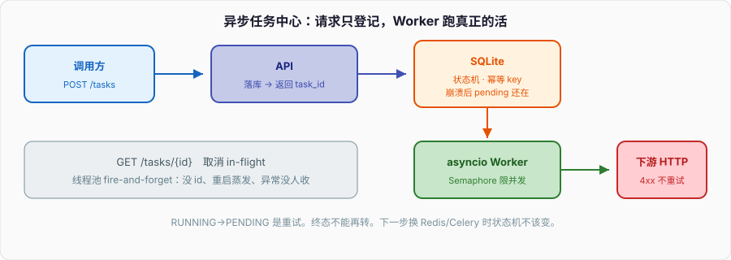
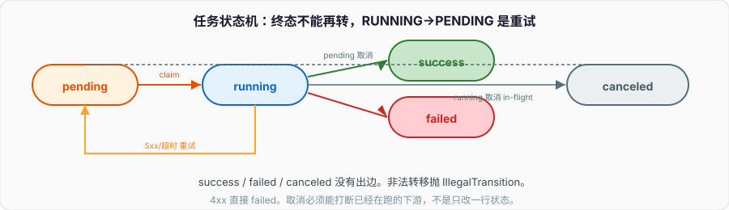

# 异步任务中心

请求线程里同步调下游 HTTP、写结果，P99 被最慢的那一次拖到数秒。超时一加，调用方重试，下游收到两份同样的活。正确的形状是：请求路径只负责「登记任务、返回 task_id」，真正的「调下游 + 落结果」在 Worker 里跑，可查询、可重试、可取消。

下面做一个**本地可跑**的异步任务中心。标准库 `asyncio` + `sqlite3`，HTTP 用可替换的下游端口，不引入 Celery / Redis / arq。能把状态机、重试、取消、观测跑通；分布式调度留给最后一节的演进路径。

---

## 一、目标与非目标

### 1、目标

- 提交 / 查询 / 取消（pending 与 running 都要能真正打断 in-flight）
- 5xx / 超时指数退避 + 抖动，4xx 不重试；崩溃后 pending / 过期 running 可恢复
- 并发上限 N；结构化日志：`task_id` / `state` / `duration_ms` / `retry`

### 2、非目标

- **不做分布式调度。** 单进程、一份 SQLite。多 Worker 抢同一行要用到租约 / `UPDATE … WHERE state=`，本篇只做到「崩溃恢复」，不做多机互斥。
- **不做多租户。** 没有账号、配额、按租户隔离队列。
- **不做优先级队列、定时任务、DAG。** 一种任务类型：HTTP POST + 把响应写入结果列。
- **不引入 Redis / Celery / arq / RabbitMQ。** 演进见第十三节。

C++ 里这相当于：请求线程往无锁队列丢 job，后台 `asio` 线程跑；Go 里是 `go func()` + 自己的 store。Python 默认把「开个线程池 `submit` 就不管了」当成异步，结果任务丢了没人知道。本篇把「不管了」换成有状态机的队列。



---

## 二、目录结构

```
taskcenter/
  pyproject.toml
  taskcenter/
    __init__.py
    models.py          # 状态枚举、Task 记录、非法转移
    store.py           # SQLite：建表、抢任务、写回
    downstream.py      # 下游端口 + 假实现 + 阻塞客户端
    retry.py           # 4xx/5xx/超时、退避
    worker.py          # asyncio 循环、Semaphore、取消
    api.py             # HTTP 层骨架（aiohttp 风格）
    log.py             # 结构化日志
    main.py            # 拼起来跑
  tests/
    test_state.py
    test_retry.py
    test_cancel.py
```

核心零第三方（`requires-python >= 3.11`）。HTTP 客户端用端口抽象，测试走假下游。下面每个模块是能粘贴运行的关键代码，不是空函数名。

---

## 三、任务模型与状态机

### 1、状态

```python
# taskcenter/models.py
from __future__ import annotations

from dataclasses import dataclass
from enum import Enum
from typing import Final


class State(str, Enum):
    PENDING = "pending"
    RUNNING = "running"
    SUCCESS = "success"
    FAILED = "failed"
    CANCELED = "canceled"


TERMINAL: Final[set[State]] = {State.SUCCESS, State.FAILED, State.CANCELED}

ALLOWED: Final[dict[State, frozenset[State]]] = {
    State.PENDING:  frozenset({State.RUNNING, State.CANCELED}),
    State.RUNNING:  frozenset({State.SUCCESS, State.FAILED, State.CANCELED, State.PENDING}),
    State.SUCCESS:  frozenset(),
    State.FAILED:   frozenset(),
    State.CANCELED: frozenset(),
}
```

`RUNNING → PENDING` 是重试：这一轮失败但还能再试，放回队列。终态不能再转。



```python
class IllegalTransition(Exception):
    def __init__(self, src: State, dst: State) -> None:
        super().__init__(f"{src.value} -> {dst.value}")
        self.src, self.dst = src, dst


def transit(src: State, dst: State) -> State:
    if dst not in ALLOWED[src]:
        raise IllegalTransition(src, dst)
    return dst
```

### 2、记录

```python
@dataclass
class Task:
    id: str
    state: State
    url: str
    body: bytes
    idempotency_key: str
    attempt: int
    max_attempts: int
    result: bytes | None
    error: str | None
    created_at: float
    updated_at: float
    started_at: float | None
    finished_at: float | None


def can_retry(t: Task) -> bool:
    return t.attempt < t.max_attempts
```

幂等 key 的语义：提交时若已有相同 key 且非终态，返回已有 id，不建第二条。终态后同一 key 是否允许再跑，产品决定；本篇**终态后拒绝**，避免「成功了又来一次」把下游打成两次副作用。需要「成功后强制重跑」走单独的 `requeue` API，不要复用提交入口。

C++ 里状态机常用 enum class + 一张转移表；Go 里 `iota` + 方法 `func (s State) CanGo(to State) bool`。Python 用 `Enum` 序列化成字符串存 SQLite，不要存数字——翻库时能读。

---

## 四、存储：SQLite

### 1、表结构

`id` 主键，`state` 存字符串（翻库能读），`idempotency_key UNIQUE`：并发提交同一 key，只有一条 `INSERT` 成功，另一条走 `IntegrityError` 再 `SELECT`。`idx_tasks_state` 给 claim 用。DDL 写在下面 `SCHEMA` 里，不要两份。

### 2、仓库实现

`sqlite3` 默认连接不是跨线程分享的；asyncio 里不要在 loop 线程里跑可能阻塞的磁盘。本篇把 store 的同步调用丢到 `asyncio.to_thread`。单文件 SQLite 写锁粗，教学项目够用。

```python
# taskcenter/store.py
from __future__ import annotations

import sqlite3
import threading
import time
import uuid
from pathlib import Path

from .models import IllegalTransition, State, Task, transit

SCHEMA = """
CREATE TABLE IF NOT EXISTS tasks (
    id               TEXT PRIMARY KEY,
    state            TEXT NOT NULL,
    url              TEXT NOT NULL,
    body             BLOB NOT NULL,
    idempotency_key  TEXT NOT NULL UNIQUE,
    attempt          INTEGER NOT NULL DEFAULT 0,
    max_attempts     INTEGER NOT NULL,
    result           BLOB,
    error            TEXT,
    created_at       REAL NOT NULL,
    updated_at       REAL NOT NULL,
    started_at       REAL,
    finished_at      REAL
);
CREATE INDEX IF NOT EXISTS idx_tasks_state ON tasks(state);
"""


def connect(path: str | Path) -> sqlite3.Connection:
    conn = sqlite3.connect(path, timeout=5.0, isolation_level=None, check_same_thread=False)
    conn.row_factory = sqlite3.Row
    conn.execute("PRAGMA journal_mode=WAL")
    conn.execute("PRAGMA foreign_keys=ON")
    conn.executescript(SCHEMA)
    return conn


def _row_to_task(r: sqlite3.Row) -> Task:
    res = r["result"]
    return Task(
        id=r["id"], state=State(r["state"]), url=r["url"], body=bytes(r["body"]),
        idempotency_key=r["idempotency_key"], attempt=r["attempt"],
        max_attempts=r["max_attempts"], result=None if res is None else bytes(res),
        error=r["error"], created_at=r["created_at"], updated_at=r["updated_at"],
        started_at=r["started_at"], finished_at=r["finished_at"],
    )


class Store:
    def __init__(self, conn: sqlite3.Connection) -> None:
        self._c = conn
        self._lock = threading.Lock()   # to_thread 多线程碰同一连接

    def submit(self, url: str, body: bytes, idem_key: str, max_attempts: int = 3) -> Task:
        with self._lock:
            now = time.time()
            tid = uuid.uuid4().hex
            try:
                self._c.execute("BEGIN IMMEDIATE")
                self._c.execute(
                    """INSERT INTO tasks
                       (id, state, url, body, idempotency_key, attempt, max_attempts,
                        created_at, updated_at)
                       VALUES (?, ?, ?, ?, ?, 0, ?, ?, ?)""",
                    (tid, State.PENDING.value, url, body, idem_key, max_attempts, now, now),
                )
                self._c.execute("COMMIT")
            except sqlite3.IntegrityError:
                self._c.execute("ROLLBACK")
                row = self._c.execute(
                    "SELECT * FROM tasks WHERE idempotency_key = ?", (idem_key,)
                ).fetchone()
                if row is None:
                    raise
                return _row_to_task(row)
            return self._get(tid)

    def get(self, tid: str) -> Task:
        with self._lock:
            return self._get(tid)

    def _get(self, tid: str) -> Task:
        row = self._c.execute("SELECT * FROM tasks WHERE id = ?", (tid,)).fetchone()
        if row is None:
            raise KeyError(tid)
        return _row_to_task(row)

    def claim_one(self) -> Task | None:
        with self._lock:
            now = time.time()
            self._c.execute("BEGIN IMMEDIATE")
            row = self._c.execute(
                """SELECT * FROM tasks WHERE state = ? ORDER BY created_at LIMIT 1""",
                (State.PENDING.value,),
            ).fetchone()
            if row is None:
                self._c.execute("COMMIT")
                return None
            transit(State(row["state"]), State.RUNNING)
            self._c.execute(
                """UPDATE tasks SET state = ?, attempt = attempt + 1,
                   started_at = ?, updated_at = ? WHERE id = ?""",
                (State.RUNNING.value, now, now, row["id"]),
            )
            self._c.execute("COMMIT")
            return self._get(row["id"])

    def mark(self, tid: str, dst: State, *, result: bytes | None = None,
             error: str | None = None) -> Task:
        with self._lock:
            self._c.execute("BEGIN IMMEDIATE")
            row = self._c.execute("SELECT * FROM tasks WHERE id = ?", (tid,)).fetchone()
            if row is None:
                self._c.execute("ROLLBACK")
                raise KeyError(tid)
            try:
                transit(State(row["state"]), dst)
            except IllegalTransition:
                self._c.execute("ROLLBACK")
                raise
            now = time.time()
            finished = now if dst in {State.SUCCESS, State.FAILED, State.CANCELED} else None
            self._c.execute(
                """UPDATE tasks SET state = ?, result = ?, error = ?,
                   updated_at = ?, finished_at = COALESCE(?, finished_at) WHERE id = ?""",
                (dst.value, result, error, now, finished, tid),
            )
            self._c.execute("COMMIT")
            return self._get(tid)

    def recover_stale_running(self, older_than_s: float = 600.0) -> int:
        with self._lock:
            cutoff = time.time() - older_than_s
            cur = self._c.execute(
                """UPDATE tasks SET state = ?, updated_at = ?
                   WHERE state = ? AND started_at IS NOT NULL AND started_at < ?""",
                (State.PENDING.value, time.time(), State.RUNNING.value, cutoff),
            )
            return cur.rowcount
```

`BEGIN IMMEDIATE` 抢写锁，避免「读到 pending、还没 UPDATE，另一边也读到」。单进程 asyncio 里同一时刻只有一条协程在 `to_thread` 里跑 store 也可以活；写成 IMMEDIATE 是为了下一节「真多线程 store」时不改语义。

崩溃恢复不要把 `running` 当成功。Worker 启动先 `recover_stale_running`。阈值要大于单次下游超时 × 最大重试，否则活着的任务会被误捡。更严的做法是心跳列 `heartbeat_at`，本篇用 `started_at` 凑合。

---

## 五、下游调用、超时、重试

### 1、端口

```python
# taskcenter/downstream.py
from __future__ import annotations

from dataclasses import dataclass
from typing import Protocol


@dataclass(frozen=True)
class DownResponse:
    status: int
    body: bytes


class Downstream(Protocol):
    async def post(self, url: str, body: bytes, *, timeout: float) -> DownResponse: ...
```

生产换成 `aiohttp.ClientSession.post`；阻塞的 `urllib` / `requests` 包进 executor。假下游给测试：

```python
class FakeDownstream:
    def __init__(self, seq: list[DownResponse | BaseException]) -> None:
        self.seq = list(seq)
        self.calls = 0

    async def post(self, url: str, body: bytes, *, timeout: float) -> DownResponse:
        self.calls += 1
        if not self.seq:
            raise RuntimeError("fake exhausted")
        item = self.seq.pop(0)
        if isinstance(item, BaseException):
            raise item
        return item
```

阻塞客户端：`urlopen` / `requests` 包进 `asyncio.to_thread`。timeout 是阻塞超时，loop 能让出，但 **`Task.cancel()` 杀不掉那个线程**——取消节会再钉这句。教学路径用假下游或 aiohttp；接同步 SDK 时取消只能保证「不再写结果」。

```python
class UrllibDownstream:
    async def post(self, url: str, body: bytes, *, timeout: float) -> DownResponse:
        def _call() -> DownResponse:
            req = Request(url, data=body, method="POST")
            try:
                with urlopen(req, timeout=timeout) as resp:
                    return DownResponse(resp.status, resp.read())
            except HTTPError as e:
                return DownResponse(e.code, e.read())
        return await asyncio.to_thread(_call)
```

### 2、什么该重试

```python
# taskcenter/retry.py
from __future__ import annotations

import random
from dataclasses import dataclass


@dataclass(frozen=True)
class RetryPlan:
    should: bool
    delay_s: float
    reason: str


def classify(status: int | None, exc: BaseException | None, attempt: int, max_attempts: int) -> RetryPlan:
    if attempt >= max_attempts:
        return RetryPlan(False, 0.0, "max_attempts")
    if exc is not None:
        if isinstance(exc, TimeoutError | ConnectionError | OSError):
            return RetryPlan(True, backoff(attempt), type(exc).__name__)
        return RetryPlan(False, 0.0, type(exc).__name__)
    assert status is not None
    if 500 <= status <= 599:
        return RetryPlan(True, backoff(attempt), f"http_{status}")
    if 400 <= status <= 499:
        return RetryPlan(False, 0.0, f"http_{status}")
    if 200 <= status <= 299:
        return RetryPlan(False, 0.0, "ok")
    return RetryPlan(False, 0.0, f"http_{status}")


def backoff(attempt: int, base: float = 0.2, cap: float = 8.0) -> float:
    # attempt 从 1 起。2^(n-1)*base，加等幅抖动，封顶。
    raw = min(cap, base * (2 ** (attempt - 1)))
    jitter = raw * 0.5 * random.random()
    return raw + jitter
```

4xx 是调用方的错（404/400/401），再试还是 4xx，浪费下游。429 在真实系统里该重试并认 `Retry-After`；本篇把它当 4xx 不重试，演进时再拆。5xx 和超时、连接失败重试。幂等：下游必须能吞重复 POST（用你传的幂等 key 当头），否则重试会双写。任务中心的幂等 key 解决的是「提交两次只建一条」；下游自己的幂等是另一件事，两边都要。

指数退避必加抖动。一群任务同时失败、同一时刻醒来，会打出惊群。C++ / Go 里同一条：`delay = min(cap, base<<n) + rand()`。

---

## 六、Worker：asyncio + Semaphore

```python
# taskcenter/worker.py
from __future__ import annotations

import asyncio
import time

from .downstream import Downstream
from .log import log
from .models import State, Task, can_retry
from .retry import classify
from .store import Store


class Worker:
    def __init__(
        self,
        store: Store,
        down: Downstream,
        *,
        concurrency: int = 8,
        poll_interval: float = 0.05,
        call_timeout: float = 5.0,
    ) -> None:
        self._store = store
        self._down = down
        self._sem = asyncio.Semaphore(concurrency)
        self._poll = poll_interval
        self._timeout = call_timeout
        self._stop = asyncio.Event()
        self._inflight: dict[str, asyncio.Task[None]] = {}

    def _run_sync(self, fn, *args, **kw):
        return asyncio.to_thread(fn, *args, **kw)  # sqlite3 同步；mark() 的 result/error 是仅关键字

    async def run_forever(self) -> None:
        await self._run_sync(self._store.recover_stale_running)
        while not self._stop.is_set():
            t = await self._run_sync(self._store.claim_one)
            if t is None:
                try:
                    await asyncio.wait_for(self._stop.wait(), timeout=self._poll)
                except TimeoutError:
                    pass
                continue
            await self._sem.acquire()
            task = asyncio.create_task(self._guarded_run(t), name=f"job-{t.id}")
            self._inflight[t.id] = task

    async def _guarded_run(self, t: Task) -> None:
        try:
            await self._run_one(t)
        finally:
            self._inflight.pop(t.id, None)
            self._sem.release()

    async def _run_one(self, t: Task) -> None:
        t0 = time.perf_counter()
        log("task_start", task_id=t.id, attempt=t.attempt, url=t.url)
        fresh = await self._run_sync(self._store.get, t.id)
        if fresh.state == State.CANCELED:
            log("task_skip_canceled", task_id=t.id, duration_ms=0)
            return
        try:
            resp = await asyncio.wait_for(
                self._down.post(t.url, t.body, timeout=self._timeout),
                timeout=self._timeout + 0.1,
            )
            exc: BaseException | None = None
            status: int | None = resp.status
            body: bytes | None = resp.body
        except TimeoutError as e:
            exc, status, body = e, None, None
        except asyncio.CancelledError:
            log("task_interrupted", task_id=t.id,
                duration_ms=int((time.perf_counter() - t0) * 1000))
            raise
        except BaseException as e:
            exc, status, body = e, None, None

        plan = classify(status, exc, t.attempt, t.max_attempts)
        duration_ms = int((time.perf_counter() - t0) * 1000)

        if status is not None and 200 <= status <= 299:
            await self._run_sync(self._store.mark, t.id, State.SUCCESS, result=body, error=None)
            log("task_done", task_id=t.id, state="success", retry=t.attempt,
                duration_ms=duration_ms, http_status=status)
            return

        if plan.should and can_retry(t):
            await asyncio.sleep(plan.delay_s)
            try:
                await self._run_sync(self._store.mark, t.id, State.PENDING, error=plan.reason)
            except Exception:
                log("task_retry_aborted", task_id=t.id, reason=plan.reason)
                return
            log("task_retry", task_id=t.id, reason=plan.reason, delay_s=round(plan.delay_s, 3),
                retry=t.attempt, duration_ms=duration_ms)
            return

        err = plan.reason if exc is None else f"{plan.reason}:{exc}"
        await self._run_sync(self._store.mark, t.id, State.FAILED, error=err)
        log("task_done", task_id=t.id, state="failed", retry=t.attempt,
            duration_ms=duration_ms, error=err)

    async def cancel(self, tid: str) -> Task:
        t = await self._run_sync(self._store.get, tid)
        if t.state in {State.SUCCESS, State.FAILED, State.CANCELED}:
            return t
        try:
            t = await self._run_sync(self._store.mark, tid, State.CANCELED, error="canceled")
        except Exception:
            t = await self._run_sync(self._store.get, tid)
            return t
        inflight = self._inflight.get(tid)
        if inflight is not None:
            inflight.cancel()
            try:
                await inflight
            except asyncio.CancelledError:
                pass
        return t

    async def stop(self) -> None:
        self._stop.set()
        jobs = list(self._inflight.values())
        for j in jobs:
            j.cancel()
        if jobs:
            await asyncio.gather(*jobs, return_exceptions=True)
```

`Semaphore` 限 in-flight 下游，不是限 pending 条数。队列在 SQLite。Go 是 `make(chan struct{}, N)`。`claim` 在 loop 里串行，并行发生在 `_run_one`。

---

## 七、取消要能真正打断

### 1、三层

1. **还没 claim**：`pending → canceled`。Worker 下次 claim 拿不到。
2. **已 claim、还没 await 下游**：`_run_one` 开头再 `get`，发现 canceled 就返回。
3. **正在 await 下游**：`inflight[tid].cancel()` 往协程扔 `CancelledError`。若下游是纯 asyncio（假下游、aiohttp），`wait_for` / `session.post` 会在下一个 await 点中断。若下游是 `to_thread(requests)`，线程继续跑完，只是结果被丢掉。

第 3 层是「真正打断」的边界。面试和事故复盘都问这一句：你的取消取消的是任务对象，还是 in-flight IO。

### 2、不要用「设个 flag 轮询」冒充

```python
# 错：下游调用期间根本不看 flag
self._canceled.add(tid)
resp = requests.post(url, data=body, timeout=30)   # 这 30s 内 cancel 是摆设
```

asyncio 取消是协作式：必须有 await。阻塞调用要么自己支持超时且你能缩短超时，要么别承诺「立刻停」。Go 的 `context.Cancel` 能传到 `http.NewRequestWithContext`；C++ `asio` 能 `cancel` socket。Python 同步 HTTP 默认没有这条管道。

---

## 八、API 层

核心调度已经是纯 asyncio。HTTP 用 aiohttp 风格伪代码，真实依赖可省略；把 handler 写成普通 async 函数，测的时候直接调。

```python
# taskcenter/api.py
from __future__ import annotations

import asyncio
import json
from dataclasses import dataclass

from .store import Store
from .worker import Worker


@dataclass
class HttpResp:
    status: int
    body: dict[str, object]


class Api:
    def __init__(self, store: Store, worker: Worker) -> None:
        self._store = store
        self._worker = worker

    async def submit(self, payload: dict[str, object]) -> HttpResp:
        url = str(payload["url"])
        body = json.dumps(payload.get("json", {})).encode()
        key = str(payload["idempotency_key"])
        max_attempts = int(payload.get("max_attempts", 3))
        t = await asyncio.to_thread(self._store.submit, url, body, key, max_attempts)
        return HttpResp(200, {"id": t.id, "state": t.state.value})

    async def get(self, tid: str) -> HttpResp:
        try:
            t = await asyncio.to_thread(self._store.get, tid)
        except KeyError:
            return HttpResp(404, {"error": "not_found"})
        return HttpResp(200, {
            "id": t.id,
            "state": t.state.value,
            "attempt": t.attempt,
            "error": t.error,
            "result": None if t.result is None else t.result.decode(errors="replace"),
            "duration_ms": _duration_ms(t),
        })

    async def cancel(self, tid: str) -> HttpResp:
        try:
            t = await self._worker.cancel(tid)
        except KeyError:
            return HttpResp(404, {"error": "not_found"})
        return HttpResp(200, {"id": t.id, "state": t.state.value})


def _duration_ms(t) -> int | None:
    if t.started_at is None:
        return None
    end = t.finished_at or t.updated_at
    return int((end - t.started_at) * 1000)
```

挂 aiohttp 时就是 `POST /tasks` → `api.submit`，`GET /tasks/{id}` → `api.get`，`POST /tasks/{id}/cancel` → `api.cancel`。不装框架也能直接测 `Api`。

提交必须同步落库再返回 id。只写内存 dict 然后 200，进程一死任务没了——第十二节对照的就是这个。

---

## 九、观测

```python
# taskcenter/log.py
from __future__ import annotations

import json
import sys
import time
from typing import Any


def log(event: str, **fields: Any) -> None:
    rec = {"ts": time.time(), "event": event, **fields}
    sys.stdout.write(json.dumps(rec, ensure_ascii=False, default=str) + "\n")
```

每条任务至少打：

| 事件 | 字段 |
| --- | --- |
| `task_start` | `task_id`, `attempt`, `url` |
| `task_retry` | `task_id`, `reason`, `delay_s`, `retry`, `duration_ms` |
| `task_done` | `task_id`, `state`, `retry`, `duration_ms`, `http_status` / `error` |
| `task_interrupted` | `task_id`, `duration_ms` |

`duration_ms` 是**这一轮**调用，不是任务从提交到终态。任务总时长用 `finished_at - created_at`，查询 API 里算。重试次数用 `attempt`，不要自己在 Worker 再维护一份计数——store 是真相。

不要用 `print(f"task {id} ok")`。后续接 OpenTelemetry 时，同一组字段变成 span attribute，事件名变成 span name。

---

## 十、拼起来跑

```python
# taskcenter/main.py
from __future__ import annotations

import asyncio
import tempfile
from pathlib import Path

from .api import Api
from .downstream import DownResponse, FakeDownstream
from .store import Store, connect
from .worker import Worker


async def demo() -> None:
    db = Path(tempfile.mkdtemp()) / "tasks.db"
    store = Store(connect(db))
    down = FakeDownstream([
        DownResponse(503, b"busy"),
        DownResponse(200, b'{"ok":true}'),
    ])
    worker = Worker(store, down, concurrency=2, poll_interval=0.02, call_timeout=1.0)
    api = Api(store, worker)

    wtask = asyncio.create_task(worker.run_forever())
    payload = {"url": "http://downstream.local/work", "json": {"n": 1},
               "idempotency_key": "k-1", "max_attempts": 3}
    r = await api.submit(payload)
    r2 = await api.submit(payload)
    print("submitted", r.body, "idempotent_same", r.body["id"] == r2.body["id"])
    for _ in range(50):
        g = await api.get(str(r.body["id"]))
        if g.body["state"] in {"success", "failed", "canceled"}:
            print("final", g.body)
            break
        await asyncio.sleep(0.05)
    await worker.stop()
    wtask.cancel()
    try:
        await wtask
    except asyncio.CancelledError:
        pass


if __name__ == "__main__":
    asyncio.run(demo())
```

预期：第一次下游 503，退避后第二次 200，终态 `success`，`attempt == 2`。同一 `idempotency_key` 两次 submit 返回同一 id。把 `FakeDownstream` 换成两次 400，终态 `failed` 且 `calls == 1`。

`__init__.py` 留空。`python -m taskcenter.main`。

---

## 十一、测试思路

假下游、内存 SQLite（`":memory:"` 注意：**每个连接一份库**，测试里共用同一个 `connect` 返回的 conn）。

```python
# tests/test_state.py
from taskcenter.models import IllegalTransition, State, transit

def test_pending_to_running() -> None:
    assert transit(State.PENDING, State.RUNNING) is State.RUNNING

def test_success_is_terminal() -> None:
    try:
        transit(State.SUCCESS, State.PENDING)
        raise AssertionError("expected IllegalTransition")
    except IllegalTransition as e:
        assert e.src is State.SUCCESS
```

```python
# tests/test_retry.py
import asyncio
from taskcenter.downstream import DownResponse, FakeDownstream
from taskcenter.store import Store, connect
from taskcenter.worker import Worker

async def _drain(store, w, tid, want: str) -> None:
    run = asyncio.create_task(w.run_forever())
    for _ in range(100):
        if store.get(tid).state.value == want:
            break
        await asyncio.sleep(0.02)
    await w.stop(); run.cancel()

async def test_5xx_retries_then_ok() -> None:
    store = Store(connect(":memory:"))
    down = FakeDownstream([DownResponse(503, b""), DownResponse(200, b"ok")])
    w = Worker(store, down, poll_interval=0.01, call_timeout=0.5)
    t = store.submit("http://x", b"{}", "k", max_attempts=3)
    await _drain(store, w, t.id, "success")
    cur = store.get(t.id)
    assert cur.state.value == "success" and cur.attempt == 2 and down.calls == 2

async def test_4xx_no_retry() -> None:
    store = Store(connect(":memory:"))
    down = FakeDownstream([DownResponse(400, b"bad")])
    w = Worker(store, down, poll_interval=0.01, call_timeout=0.5)
    t = store.submit("http://x", b"{}", "k2", max_attempts=5)
    await _drain(store, w, t.id, "failed")
    assert down.calls == 1 and store.get(t.id).attempt == 1
```

```python
# tests/test_cancel.py
import asyncio
from taskcenter.downstream import DownResponse
from taskcenter.store import Store, connect
from taskcenter.worker import Worker

class SlowDown:
    def __init__(self) -> None:
        self.entered = asyncio.Event()
        self.calls = 0

    async def post(self, url: str, body: bytes, *, timeout: float) -> DownResponse:
        self.calls += 1
        self.entered.set()
        await asyncio.sleep(30)          # 可被 cancel 打断
        return DownResponse(200, b"late")

async def test_cancel_interrupts_running() -> None:
    store = Store(connect(":memory:"))
    down = SlowDown()
    w = Worker(store, down, poll_interval=0.01, call_timeout=60)
    t = store.submit("http://x", b"{}", "kc", max_attempts=1)
    run = asyncio.create_task(w.run_forever())
    await asyncio.wait_for(down.entered.wait(), timeout=2)
    got = await w.cancel(t.id)
    assert got.state.value == "canceled"
    await asyncio.sleep(0.05)
    assert store.get(t.id).result is None
    await w.stop(); run.cancel()
```

`SlowDown` 在 `await sleep` 上让出，`Task.cancel()` 能进 `CancelledError`。若把 `sleep` 换成 `time.sleep(30)` 且丢进 `to_thread`，这个测试会失败或只能断言「结果没写成 success」——那正好证明第七节的边界。

测重试上限：连续 5xx，`max_attempts=3`，`calls == 3`，终态 failed。测幂等：两次 `submit` 同一 key，id 相同，下游只被打到一次（第二次 submit 时任务可能已经 success，仍然同 id）。

---

## 十二、和「开个线程池 fire-and-forget」对比

常见写法：

```python
from concurrent.futures import ThreadPoolExecutor

pool = ThreadPoolExecutor(max_workers=32)

def handle(req):
    pool.submit(call_downstream_and_write, req.body)
    return {"ok": True}
```

| | 线程池扔了就走 | 本篇任务中心 |
| --- | --- | --- |
| 提交是否持久 | 否，在内存 Future 里 | 是，SQLite 先落再 200 |
| 进程重启 | 队列蒸发，调用方以为成功 | pending 还在，Worker 接着跑 |
| 查询 | 没有 id，最多自己塞 dict | `GET /tasks/{id}` |
| 重试 | 函数里手写，和查询无关 | 状态机 + attempt 列 |
| 取消 | `Future.cancel()` 对已开始的线程无效 | 协作式打断 asyncio 下游 |
| 背压 | 32 个线程，再来的进无界队列，RSS 涨 | pending 在库里，Semaphore 限 in-flight |
| 观测 | 线程名 + print | 每任务 duration / retry 字段 |

丢任务的两条典型路径：

1. `submit` 成功、进程被 kill：Future 没跑完，磁盘上没有记录。
2. 线程里抛了异常，没人 `future.result()`：异常在线程池里变成日志或静默（取决于版本和 `done_callback`）。调用方 200 已经返回。

难查：没有 task_id，日志只能拿业务主键碰。P99 分不清排队还是下游。线程池不是不能用——`to_thread` 就是。差别是身份在持久层。Go `go func(){ http.Post() }`、C++ `detach()` 同一类问题。

---

## 十三、下一步：Redis / Celery / arq，本篇不引入

本篇验证的是模型：状态机、幂等、重试分类、取消语义、观测字段。换存储和调度时这些不该变。

| 演进 | 换什么 | 不换什么 |
| --- | --- | --- |
| Redis Stream / List + 消费者组 | `store.py` 变成 XADD / XREADGROUP；ack 对应终态 | `models.py`、`retry.py`、`Downstream` |
| arq（asyncio + Redis） | Worker 循环和 job 装饰器 | 4xx/5xx 策略、幂等 key |
| Celery + broker | 进程模型变成 prefork，任务写成 `@app.task` | 取消语义要重新读 Celery revoke（默认不杀立刻） |
| 多机 | claim 用 `UPDATE … WHERE state='pending'` 或 broker 租约 | 单条任务的状态机 |
| 多租户 | 表加 `tenant_id`，队列按租户限流 | 下游端口 |

Celery 默认 pickle 序列化、默认 ack 时机、`revoke` 对已经在跑的 prefork 子进程是发信号，不是 asyncio 取消。上 Celery 之前把本篇的测试矩阵（4xx 不重试、5xx 到上限、取消 in-flight）对着 Celery 配置逐条打勾，不要假设框架替你做了同一套语义。

arq 更接近本篇：本身就是 asyncio Worker + Redis。迁移成本小，代价是 Redis 运维和 at-least-once（崩溃会再投，下游必须幂等）。
先把单机 SQLite 跑绿。状态机错了，换 Redis 只是把错的状态复制到更快的介质上。
