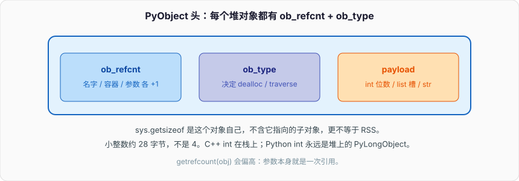
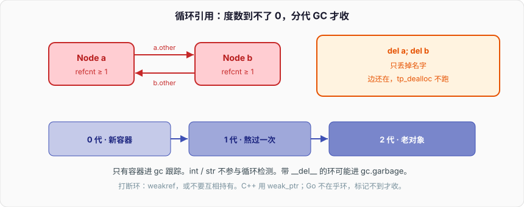

# 内存管理与垃圾回收

缓存 dict 越来越大，进程 RSS 只涨不跌。`del cache[k]` 之后 `len(cache)` 下来了，`/proc/self/status` 里的 `VmRSS` 还在原地。再糟一点：两个对象互相指着，`del a; del b` 之后引用计数到不了零，块还在堆上。

```python
import sys

cache: dict[str, bytes] = {}

def fill(n: int, payload: int = 64_000) -> None:
    for i in range(n):
        cache[f"k{i}"] = b"x" * payload     # 每条 ~64KB，外加 str key、dict 槽


def rss_kb() -> int:
    # Linux；macOS 用 resource.ru_maxrss，单位字节，口径不同
    with open("/proc/self/status") as f:
        for line in f:
            if line.startswith("VmRSS:"):
                return int(line.split()[1])
    return -1


fill(2000)
print("full", len(cache), "rss", rss_kb(), "sizeof_cache", sys.getsizeof(cache))
cache.clear()
print("cleared", len(cache), "rss", rss_kb(), "sizeof_cache", sys.getsizeof(cache))
```

`getsizeof(cache)` 只是 dict 对象头加哈希表槽位，不含 value 指向的 `bytes`。`clear` 之后引用计数该降，小对象却多半还趴在 pymalloc 的 arena 里，arena 很少还给 OS。环则更彻底：引用计数根本走不到 `tp_dealloc`。

C++ 里 `unique_ptr` 离开关闭作用域，内存立刻走分配器；`shared_ptr` 环要 `weak_ptr` 打断。Go 没有引用计数，三色标记加写屏障，环不是问题，暂停模型是。CPython 两套机制叠在一起：热路径靠引用计数立刻回收，环靠分代 GC 扫。下面按对象头、分配器、引用计数、环、弱引用、intern、泄漏、tracemalloc 往下拆。本机 RSS 数字会不同，arena 不回给 OS 这条不会。

---

## 一、PyObject 头：`ob_refcnt` + `ob_type`

### 1、每个堆对象都有一份

CPython 里几乎所有你能拿到的东西都是 `PyObject*`。公共头（简化）：

```c
typedef struct _object {
    Py_ssize_t ob_refcnt;       /* 引用计数；free-threaded 构建里形态不同 */
    PyTypeObject *ob_type;      /* 类型对象，决定 tp_dealloc / tp_traverse */
} PyObject;
```

变长对象再加 `ob_size`（`PyVarObject`）：`list`、`tuple`、`str`、`bytes`、`int` 的数字位数。64 位官方构建上，一个空对象光头就要 16 字节量级，加上分配器对齐，`sys.getsizeof(object())` 常见 16 或 32，不是「一个指针」。



```python
import sys

print(sys.getsizeof(0))          # 小 int 常驻池，仍有对象头
print(sys.getsizeof(1))
print(sys.getsizeof([]))         # 空 list：头 + 预留槽指针数组
print(sys.getsizeof([1, 2, 3]))  # 比空 list 大，仍不含元素对象本身
print(sys.getsizeof(""))
print(sys.getsizeof("a" * 100))
```

`getsizeof(lst)` **不**递归。`[b"x" * 10_000]` 的 sizeof 只是 list 结构；10KB 的 `bytes` 另算。要整棵对象图，自己 BFS，或用 `pympler.asizeof`（第三方）。RSS 是进程地址空间里 resident 的页，和 sizeof 不是一个量。

### 2、类型对象决定怎么死

`ob_type->tp_dealloc` 在计数到 0 时调。`list` 的 dealloc 会 `Py_DECREF` 每个元素，再把槽数组 `free` 掉，再把 list 对象还回分配器。`tp_traverse` / `tp_clear` 是 GC 用的：只给「可能参与环」的容器类型。`int` / `str` / `bytes` 没有这两槽，不进 GC 链表。

C++ 对应的是 vtable：析构函数由动态类型决定。Go 的类型信息给 GC 扫描器用，没有 per-object 引用计数字段（指针带写屏障）。CPython 两个都有：计数在对象头，扫描函数在类型对象上。

### 3、`sys.getsizeof` 不等于 RSS

RSS 包含：

- 解释器 `.text` / `.data`、动态库
- Python 堆（pymalloc arena + raw malloc）
- 线程栈、JIT 不在 CPython 默认路径
- 已 `free` 但分配器没归还 OS 的空洞
- 文件映射、匿名 mmap（`shared_memory`、大 `bytes` 有时走 mmap）

所以：

- `del` 一个 64KB `bytes`，sizeof 账立刻少，RSS 可能不动（页还在 malloc 空闲链表）
- 造一千万个小 int 以外的对象，sizeof 加起来和 RSS 对不上（对象头、对齐、池、碎片）
- 子进程 `fork` 后 RSS 写时复制，看着「自己很小」，一写全爆

看泄漏看趋势：连续操作前后的 RSS / `tracemalloc`，不要拿一次 `getsizeof` 对账单。

### 4、3.13 free-threaded 下对象头会变

PEP 703 的构建里引用计数不是单线程的 `++/--`。对象头更大或布局不同，偏置计数、线程本地、合并到主计数。`sys.getsizeof` 数字会和官方 GIL 构建不一致。这篇文章默认 **带 GIL 的 3.11–3.13 官方构建**；free-threaded 只在和原子性、扩展有关时点一下。不要用 GIL 构建的 sizeof 去推无 GIL 的内存账。

---

## 二、分配器：pymalloc 和小对象

### 1、三条路径

CPython 的 `PyObject_Malloc`：

| 大小 | 谁分配 | 特征 |
| --- | --- | --- |
| 0–512 字节（含对齐） | pymalloc | arena → pool → block；按 8/16 字节 class |
| 更大 | 系统 `malloc` / `mmap` | 大 `bytes`、大 list 的槽数组 |
| 特殊 | 自己的池 | 小 int、空 tuple、intern 的 str、free list（frame、list 等历史上有） |

512 是 `_PyMalloc_SMALL_REQUEST_THRESHOLD` 这一档的量级，版本间可能微调，心智按「小对象走 pymalloc」即可。

### 2、arena / pool / block

```
arena   256 KiB 向 OS 要的大块（对齐）
  pool    4 KiB，属于某一个 size class
    block   8B、16B、24B … 固定大小切片
```

分配 24 字节对象：找到 24B 的 pool，弹出一个 block。释放：block 回到该 pool 的 free list，**不**把 256KiB arena 还给 OS——除非整个 arena 里所有 pool 都空，而且实现决定 munmap。长时间跑的服务里，这个「除非」很少发生。这就是开篇 `cache.clear()` 后 RSS 不跌的主因之一。

碎片有两种：

- **内部**：24B class 分给 17B 的对象，浪费对齐
- **外部**：pool 按 class 绑死。大量 32B 对象把 arena 切成 32B pool，改成分配 64B 时，这些页帮不上忙，只能再要 arena

C++ `std::allocator` / jemalloc / tcmalloc 同一类问题：`free` 不等于 `sbrk` 回退。Go 的 GC 会把空 span 还给 OS（`debug.FreeOSMemory` 可催），比 pymalloc 积极。CPython 想压 RSS，往往要进程重启、子进程隔离、或自己用 `malloc_trim`（glibc，不保证）——不是 `gc.collect()`。


### 3、大对象走系统 malloc

`bytes` 超过阈值不再进 pymalloc，直接 `malloc`。glibc 对大块常用 `mmap`，`free` 时 `munmap`，RSS **会**掉。所以「清一个 50MB 的 `bytes`」和「清五万个 1KB 的 dict 项」观感完全不同：前者 RSS 可能立刻下降，后者几乎不降。

list 对象本身可能是小的，它的 `ob_item` 指针数组随长度走 malloc。`lst.clear()` 把元素 DECREF，数组可能缩也可能留着容量——`clear` 在 list 上会把容量收回（CPython 实现如此），但元素如果是小对象，它们的 block 仍在 pymalloc。

```python
import sys

lst = [b"y" * 8 for _ in range(100_000)]   # 十万个小 bytes：pymalloc
print("list", sys.getsizeof(lst))
lst.clear()
print("after clear", sys.getsizeof(lst))   # 接近空 list
# RSS：指针数组可能还 OS；十万个 8 字节对象的池不一定
```

### 4、为什么碎片和 RSS 不回给 OS

页表粒度 4KiB。arena 里只要还活着一个对象，整页都是 RSS。缓存 dict 删了 99% 的 key，剩下 1% 均匀散在各个 arena，256KiB × N 全 resident。这叫「保留集合被钉住」。

对策：

- 缓存有上限（`lru_cache(maxsize=)`、`cachetools`、自己 FIFO）
- 大块数据用 `bytearray` / `memoryview` / 共享内存，避免百万小对象
- 会胀会缩的进程当 worker，`max_tasks_per_child` 定期换进程
- 不要指望 `gc.collect()` 降 RSS；它只把环解开，把对象还给 pymalloc

C++ 服务用 jemalloc 的 `mallctl("arena.purge")`；Go 用 `runtime/debug.FreeOSMemory`。CPython 没有同等稳定的官方 API。工程上把「RSS 必须回落」当成进程模型问题，不当成 GC 调参问题。

---

## 三、引用计数：什么时候 +1 / -1

### 1、规则

名字绑定、容器持有、解释器临时态，都会动 `ob_refcnt`：

```python
a = []          # list 对象计数 >= 1（绑定 a）
b = a           # +1
lst = [a]       # 容器槽 +1
del b           # -1
lst.pop()       # 容器放掉，-1
# 若再无别人指着，dealloc
```

函数参数：调用时实参 +1，函数返回 -1（简化；FASTCALL 等优化不改变「调用期间活着」的语义）。表达式里的临时对象，语句结束就 DECREF。循环变量 `for x in xs` 的 `x` 在下一轮被重新绑定，上一轮对象 -1。

```python
def f(x):
    return x

obj = []
print("before", ...)            # 见下一小节 getrefcount
f(obj)                          # 调用期间 +1，返回后恢复
```

C++ `shared_ptr` 拷贝构造 +1，析构 -1，语义最近。差别：Python 每次赋值都是「指针拷贝 + 计数」，没有 `unique_ptr` 这条零开销路径；也没有移动语义把计数省掉（3.x 有一些内部窃取，对用户赋值不成立）。Go 赋值不改计数，只是拷指针，活着与否交给 GC。

### 2、`sys.getrefcount` 会偏高

```python
import sys

obj = []
print(sys.getrefcount(obj))     # 常见 2：名字 obj + 函数参数
```

`getrefcount(obj)` 自己就是一次函数调用，参数槽持有一次引用，所以比「你以为的名字数」多 1。调试时永远减一，或只看相对变化。

```python
def show(x):
    print("in fn", sys.getrefcount(x))   # 再多一次参数

a = []
b = a
show(a)                         # 名字 a、b，参数 x，getrefcount 参数：更高
```

交互式 REPL 的 `_` 会多钉一次。脚本里测和 REPL 里测差 1 很正常。

### 3、赋值、参数、容器、循环结束

```python
def demo() -> None:
    xs = [i for i in range(3)]  # 推导里的 i 在 3.x 不泄漏到外层
    for i in xs:
        inner = [i]             # 每轮新建；上一轮 inner 计数掉到 0
    # 循环结束 i 还绑着 xs 最后一个元素
    del xs                      # list -1；若只被 xs 持有则死，元素跟着 DECREF
```

推导式和循环变量泄漏：3.x 的 list/set/dict 推导有独立作用域，`[i for i in n]` 的 `i` 出不来。`for i in n` 的 `i` 留在函数局部。最后一个元素因此多活一会儿。大循环里 `for huge in gen:` 结束后 `huge` 仍指向最后一项——显式 `del huge` 或包进函数，让帧拆掉。

异常发生时 traceback 抓住栈帧，帧抓住局部。`except` 里如果把 `exc` 存进全局 / 日志对象，整条帧链、所有局部都活着。第十一节细写。

### 4、循环里 +1/-1 的开销

纯 Python 循环里对小对象的赋值，大量时间花在 INCREF/DECREF 上。这是 GIL 存在的原因之一：计数不是原子的，要靠解释器锁串行化。free-threaded 构建把这部分变贵，单线程吞吐下降。C++ 里对应的是 `shared_ptr` 的原子计数，大家知道它慢，热路径用 `unique_ptr` 或裸指针。Python 用户层没有「这次赋值不要计数」的开关。

---

## 四、循环引用：引用计数救不了

### 1、最小环

```python
class Node:
    def __init__(self, name: str) -> None:
        self.name = name
        self.other = None


def make_cycle() -> None:
    a = Node("a")
    b = Node("b")
    a.other = b                 # a → b
    b.other = a                 # b → a
    # 离开函数：名字 a、b 没了，但 a.other / b.other 各 +1
    # 两个对象 refcnt 都 >= 1，tp_dealloc 不跑
```

`del a; del b` 只丢掉名字。对象图里还有边。引用计数是局部度数，看不见「这坨已经没人从根够到」。C++ `shared_ptr` 环同一张图；Go 不在乎环，标记不到才收。

树、双向链表、父子 widget、ORM 的 parent/children、回调把 `self` 注册进全局 dispatcher，都是环的温床。



### 2、`gc` 模块和分代

```python
import gc

print(gc.isenabled())
print(gc.get_threshold())       # (700, 10, 10) 一类的默认
print(gc.get_count())           # 距下次收集的分配差额
```

分代：

| 代 | 装什么 | 何时扫 |
| --- | --- | --- |
| 0 | 新容器 | 分配-释放差额过 `threshold0`（默认 700） |
| 1 | 熬过一次 0 代收集的 | 0 代收集次数过 `threshold1` |
| 2 | 更老 | 1 代收集次数过 `threshold2` |

新对象最可能朝生夕死。分代假设：没环的年轻对象靠引用计数已经死了；还活在 GC 链表上的，要么有环，要么还被根引用。0 代勤扫，2 代懒扫。`gc.collect(2)` 全堆扫容器，暂停和容器数相关，和对象总字节数不是线性——但容器多时也不是免费。

```python
gc.collect()                    # 返回解开的 unreachable 对象数
gc.set_threshold(700, 10, 10)
gc.disable()                    # 关掉自动；手动 collect。一般不要
```

CPython 的 GC 是 **标记-清环**，不是把整个堆 compact。活着的对象不搬家。清的是「外部引用为 0 的环」。算法：

1. 对跟踪中的容器做 `tp_traverse`，把内部边对应的计数 **减掉**（只在 GC 的副本账上）
2. 减完仍 > 0 的，说明有环外的根（名字、栈、模块）指着，它们是活的，连带着能到的都活
3. 减完变成 0 的，是纯环，调 `tp_clear` 拆边，再 dealloc

这一步只走容器类型。`int` 不参与。

### 3、容器才进 gc 跟踪；原子类型不参与循环检测

```python
import gc

print(gc.is_tracked([]))        # True
print(gc.is_tracked({}))        # True
print(gc.is_tracked(set()))     # True
print(gc.is_tracked(1))         # False
print(gc.is_tracked("abc"))     # False
print(gc.is_tracked(b"abc"))    # False
print(gc.is_tracked(None))      # False
```

实例对象：如果定义了 `__dict__` 或 `__slots__` 里有可指向别的对象的槽，通常是 tracked。纯 `__slots__` 且槽都是原子、类型声明不能成环的，优化后可能不跟踪——不要依赖这个优化写正确性。自己写 C 扩展，必须填 `tp_traverse` / `tp_clear`，否则环泄漏，GC 看不见。

为什么原子类型不进：它们不能指向别的 Python 对象，构不成环。跟踪它们只有开销。`tuple` 比较特殊：全是不可跟踪元素的 tuple 可以不跟踪（3.x 的优化）；一旦有一个元素是容器，tuple 自己也要被扫，因为 `a = []; t = (a,); a.append(t)` 就是环。

```python
a: list[object] = []
t = (a,)
a.append(t)
del a, t
n = gc.collect()
print("collected", n)           # >= 2
```

### 4、`gc.get_objects` / `collect` / `set_debug` / `garbage`

```python
import gc

gc.set_debug(gc.DEBUG_SAVEALL)  # 解开的环进 gc.garbage，而不是立刻释放——调试用
objs = gc.get_objects()         # 当前跟踪的所有容器，贵，生产禁开
print(len(objs))

n = gc.collect()
print("unreachable", n)
print("garbage", len(gc.garbage))
gc.set_debug(0)
gc.garbage.clear()
```

`get_objects()` 返回的 list 自己也是对象，还会 INCREF 里面每一项——测泄漏时它会干扰现场。`DEBUG_LEAK` = `DEBUG_COLLECTABLE | DEBUG_UNCOLLECTABLE | DEBUG_SAVEALL`，stderr 打日志。

`gc.garbage` 装 **无法自动回收** 的东西，历史上主要是带 `__del__` 的环。3.4 起大部分 `__del__` 环也能收（PEP 442），`garbage` 通常是空的。还能看到的，多半是：

- 老扩展没实现 `tp_clear`
- 你开了 `DEBUG_SAVEALL`
- 极少数 finalizer 互相依赖、GC 放弃的对象

生产打开 `DEBUG_SAVEALL` 等于人为泄漏。只在复现时开。

---

## 五、`__del__` 和环的矛盾

### 1、终结器在环上的问题

```python
class Fileish:
    def __init__(self, name: str) -> None:
        self.name = name
        self.peer = None

    def __del__(self) -> None:
        print("del", self.name)


def leak() -> None:
    a = Fileish("a")
    b = Fileish("b")
    a.peer = b
    b.peer = a
```

3.4 之前：GC 发现环上有 `__del__`，不敢拆——不知道先调谁的 `__del__`，`a.__del__` 可能访问已死的 `b`。于是放进 `gc.garbage`，**永远不回收**，等你手动拆。3.4（PEP 442）引入安全的终结顺序：先调 `__del__`，再拆。多数环能收。

仍然不要在 `__del__` 里做业务：

- 调时机不确定（计数到 0 或 GC 扫到）
- 解释器关机时模块 dict 已拆，`__del__` 里 `open` / `logging` 会炸
- `__del__` 里如果再把 `self` 绑到全局，对象复活（resurrection），更难推理
- 生成器、`with` 的资源协议比 `__del__` 可靠——上一篇写过

C++ 析构是确定的（栈对象离开作用域、`unique_ptr` 复位）。Go 的 `SetFinalizer` 官方都不推荐当资源管理。Python 的 `__del__` 更接近 Go 的 finalizer，不接近 C++ 析构。资源用 `with`，不要用 `__del__`。

### 2、带 `__del__` 的环，调试时仍可能进 `garbage`

```python
import gc

class Node:
    def __init__(self) -> None:
        self.other = None
    def __del__(self) -> None:
        pass

gc.collect()
gc.set_debug(gc.DEBUG_SAVEALL)
a, b = Node(), Node()
a.other, b.other = b, a
del a, b
gc.collect()
print(len(gc.garbage))          # SAVEALL 下能看见
gc.set_debug(0)
gc.garbage.clear()
```

没开 SAVEALL 时 3.11–3.13 通常会把它们收掉。面试如果还背「有 `__del__` 的环一定泄漏」，补一句：3.4 之后默认能收；不保证 `__del__` 里访问得到环上另一个对象的完整状态；资源管理仍不该靠它。

### 3、`tp_clear` 必须把边砍断

自己写的容器，GC 在回收环之前调 `tp_clear`：把指向别的 Python 对象的字段置 `NULL` 并 DECREF。不清的话，环上对象互相钉着，dealloc 顺序会 use-after-free。这是 C 扩展泄漏和崩溃的常见原因：实现了 `tp_dealloc` 忘了 `tp_traverse`/`tp_clear`，GC 要么看不见环，要么拆的时候拆错。

---

## 六、弱引用：缓存、观察者、避免环

### 1、`weakref.ref` 不增加计数

```python
import weakref

class Widget:
    pass

w = Widget()
r = weakref.ref(w)
print(r() is w)                 # True，活着就返回对象
del w
print(r())                      # None，不复活
```

弱引用不进 `ob_refcnt`。对象死时，弱引用清成 `None`（或调 callback）。不能弱引用的：`int`、`str`、`bytes`、`tuple` 等（intern / 池化类型，弱引用语义会很怪）。list / dict / 用户类默认可以。需要弱引用 list / dict 时包一层子类：

```python
class WeakList(list):
    pass

r = weakref.ref(WeakList())
```

### 2、缓存：对象活着才命中

```python
from weakref import WeakKeyDictionary, WeakValueDictionary, WeakSet

# 对象当 key：对象死，表项消失。注意 key 必须可弱引用且可哈希
bound: WeakKeyDictionary[Widget, str] = WeakKeyDictionary()

# 缓存大对象：外部还有名字才留；外部丢了，缓存自动放
cache: WeakValueDictionary[str, Widget] = WeakValueDictionary()

alive: WeakSet[Widget] = WeakSet()
```

`lru_cache` 是强引用：缓存里的返回值永远钉着。`WeakValueDictionary` 相反：调用方都放手了，缓存也放手。适合「按 id 找回还活着的会话」，不适合「一定要留着最近 128 个结果」——那要用有上限的强引用 LRU。

C++ `weak_ptr` 升级要 `lock()` 成 `shared_ptr`，失败表示对象没了。Python `r()` 返回 `None` 是同一回事。Go 没有弱引用官方类型；`runtime.SetFinalizer` 不是这个用途。

### 3、观察者、回调、打破环

```python
class Subject:
    def __init__(self) -> None:
        self._obs: list[weakref.ReferenceType[Observer]] = []

    def attach(self, o: "Observer") -> None:
        self._obs.append(weakref.ref(o, lambda r: self._obs.remove(r)))

    def notify(self) -> None:
        for r in list(self._obs):
            o = r()
            if o is not None:
                o.on_event()


class Observer:
    def __init__(self, s: Subject) -> None:
        self.s = s
        s.attach(self)

    def on_event(self) -> None:
        pass
```

若 `Subject` 强引用 `Observer`，`Observer` 又持有 `Subject`，就是环。观察者列表用弱引用，观察者自己的寿命由业务名字决定。Qt / GUI / 事件总线都是这个结构。

另一个打破环的办法是把一边改成弱引用：树的 `parent` 用 `weakref`，`children` 用强引用。和 C++ `enable_shared_from_this` + `weak_ptr parent` 同构。

### 4、`finalize` 比 `__del__` 干净

```python
import weakref

class Conn:
    def __init__(self, fd: int) -> None:
        self.fd = fd
        weakref.finalize(self, Conn._close, fd)   # 不把 self 绑进回调

    @staticmethod
    def _close(fd: int) -> None:
        print("close", fd)
```

`finalize` 的回调 **禁止** 捕获 `self`，否则又是环。把需要关的 fd、path 当参数传进去。比 `__del__` 多一个确定性：可以 `atexit=True`，解释器退出时跑。仍然不如 `with`。只在你没法把寿命收进词法块时用。

---

## 七、intern、小整数池、空 tuple 单例

### 1、小整数池

CPython 把 `[-5, 256]` 的 `int` 做成单例（范围是实现细节，3.x 长期如此）：

```python
print(id(1) == id(1))           # True
print(id(256) == id(256))
a = 257
b = 257
print(a is b)                   # 编译期常量可能 True；运行时算出的常 False
```

`is` 比的是身份。小 int 用 `is` 看起来能工作，257 就越界。永远 `==`。池的意义是算术热路径少分配。这不是语言保证，PyPy、free-threaded 的具体池化策略可以不同。

C++ 没有「小 int 池」；`int` 是值。Go 的 `int` 也是值。Python 的 `int` 是对象，池是优化，不是语义。

### 2、intern 的 str

```python
import sys

print("a" is "a")               # True，字面量 intern
x = "hello"
y = "hello"
print(x is y)                   # 通常 True（编译器 intern）

u = "".join(["he", "llo"])
v = "hello"
print(u is v)                   # 常 False
sys.intern(u)
print(sys.intern(u) is sys.intern(v))  # True
```

标识符、属性名、函数名在编译期 intern，字典查找可以先比指针再比字符。自己动态拼出来的字符串不会自动 intern。`sys.intern` 把对象钉进解释器的 intern 表——**这是泄漏点**：表是进程级的，intern 过的 str 活到进程死。只 intern 有限的、会反复当 dict key 的短词。

空字符串、单字符 Latin-1 在 3.x 也有缓存。不要用 `is` 判断字符串相等。

### 3、空 tuple 单例

```python
print(() is ())                 # True
print(tuple() is tuple())
print([] is [])                 # False，list 可变，每次新建
```

空 tuple 不可变、无元素，全进程一份。`dict.keys()` 一类只读空视图也有类似「共享空对象」的优化。可变空容器每次都是新的。

### 4、free list 和「删了还能涨」

历史上 `list`、`frame`、`dict` 释放后进 per-type free list，下一个同类型分配不找 pymalloc。这会让 `get_objects` 和 RSS 的观感更怪：对象「死了」还占着 typed 池。3.11+ frame 改成特殊分配，细节在变。调试时不要假设 `del` 后该类型的分配器字节数为零。

---

## 八、内存泄漏常见原因

### 1、全局 list 当缓存

```python
_CACHE: list[bytes] = []

def add(buf: bytes) -> None:
    _CACHE.append(buf)          # 只进不出
```

模块级 list / dict 是根。引用计数永远 ≥ 1。RSS 单调增。至少要有上限、TTL、或 LRU。面试里「Python 有 GC 为什么还漏」——根上钉着的，GC 判活。

### 2、`lru_cache` 没上限

```python
from functools import lru_cache

@lru_cache(maxsize=None)        # 无界
def parse(key: str) -> bytes:
    return key.encode() * 1000
```

`maxsize=None` 是「永远记住」。参数空间无限（用户 ID、URL）时就是泄漏。默认 `maxsize=128` 的 `lru_cache` 也要看 value 多大：128 个 50MB 的数组照样把机器打满。有上限不等于有内存上限。

`cache_clear()` 只在你记得调的时候有用。Web 请求里按 user 缓存，用 TTL 缓存，不要无界 lru。

### 3、循环 + `__del__`

见第五节。3.4 后少了，C 扩展和 SAVEALL 下还在。自己的类能不用 `__del__` 就不用。

### 4、C 扩展没 `Py_DECREF`

```c
PyObject *item = PyList_GetItem(lst, i);   /* borrowed */
PyObject *dup = PyList_GetItem(lst, i);
Py_INCREF(dup);                            /* 自己要持有才 +1 */
/* 忘了 Py_DECREF(dup) → 泄漏 */
```

`GetItem` 借来的引用（borrowed）：调用方不 DECREF。`New` / `From*` 通常是新引用（new reference）：必须 DECREF 或把所有权交出去。错一类就泄漏，错另一类就 double-free。`tp_traverse` 漏字段则环永远扫不掉。Python 层看起来 `del` 了，C 还钉着。

### 5、traceback 抓住 frame

```python
import sys
import traceback

LEAK: list[object] = []

def boom() -> None:
    huge = b"z" * 10_000_000
    try:
        1 / 0
    except ZeroDivisionError:
        LEAK.append(sys.exc_info())          # (type, value, traceback)
        # traceback 对象 → 帧 → 局部 huge
```

`sys.exc_info()` 的第三项是 traceback，链到每一层帧，帧的 `f_locals` 含 `huge`。存进全局 / 日志 / 任务对象，10MB 就钉死。3.11+ 异常对象本身带 `__traceback__`，`except` 块里 `e` 活着，链就活着。

`except` 结束后，3.x 会清当前帧对异常的引用，但你存起来的不算。正确：

- 日志只留 `repr` / 格式化字符串，不留 `exc_info` 三元组
- 必须留 traceback 时 `traceback.format_exc()` 成 str
- 别在生成器 / 长期 Task 里挂着未清除的 `except` 局部名（3.11 好很多，仍别把 `e` 赋给 `self.last_exc` 还带着 tb）

### 6、其它会钉对象的根

- `threading.local` / 未 join 的 Thread 的 `target` 闭包
- `signal` 处理器、`atexit`、`weakref.finalize` 回调捕获了大对象
- `asyncio` 的 Task 没 await、在循环的集合里一直 pending
- 模块 import 缓存 `sys.modules`：模块级大对象活到进程结束
- `unittest` / pytest 的失败 traceback 保留
- 默认参数 `def f(buf=huge_list)` —— 可变默认值那篇基础里写过，它是永久根

---

## 九、tracemalloc 怎么定位

### 1、最小用法

```python
import tracemalloc

tracemalloc.start(25)           # 25 层栈，越深越准越贵

# ... 业务 ...

snap1 = tracemalloc.take_snapshot()
fill(500)                       # 可疑操作
snap2 = tracemalloc.take_snapshot()

stats = snap2.compare_to(snap1, "lineno")
for s in stats[:15]:
    print(s)
```

输出按「这一行净增了多少 KiB」排序。看到 `cache[f"k{i}"] = ...` 或某次 `append`，就是根。`tracemalloc` 跟踪的是 Python 层分配（pymalloc / PyMem），C 扩展自己 `malloc` 的看不见——那要用 `valgrind` / `jemalloc prof` / `heapprof`。

### 2、过滤和文件粒度

```python
import tracemalloc

snap = tracemalloc.take_snapshot()
filt = snap.filter_traces((
    tracemalloc.Filter(False, "<frozen importlib.*"),
    tracemalloc.Filter(False, tracemalloc.__file__),
    tracemalloc.Filter(True, "*/app/*"),
))
for s in filt.statistics("filename")[:10]:
    print(s)
```

`compare_to` 的 key：`lineno` / `filename` / `traceback`。生产抽样：`start(5)`，定时 `take_snapshot`，只保留 top N diff。全程 `start(25)` 会让分配变慢一截，内存再加一份追踪表。

### 3、和 `gc.get_objects` 搭配

```python
import gc
import sys
from collections import Counter

def by_type() -> None:
    c: Counter[str] = Counter()
    for o in gc.get_objects():
        c[type(o).__name__] += 1
    print(c.most_common(10))
```

对象个数爆的是谁：`dict`、`list`、`function`、你的 `Node`。再对某一类做 `gc.get_referrers(obj)`，看谁钉着它。`get_referrers` 极慢，且返回值会再钉一次，用完 `del`。不要在请求热路径上跑。

### 4、RSS 对不上 tracemalloc 时

tracemalloc 显示 Python 堆没涨，RSS 在涨：

- C 扩展 / 原生库（openssl、grpc、numpy 的 buffer）
- pymalloc 碎片（Python 堆「空闲」仍 resident）
- 线程栈、mmap 文件
- `fork` 后写时复制

反过来，tracemalloc 涨、RSS 不涨：分配在已有 arena 空闲 block 里，没向 OS 要新页。两套数都要看。只看 RSS 会误判「GC 没工作」；只看 tracemalloc 会漏原生泄漏。

### 5、`resource` / `psutil` 做外圈

```python
import resource

print(resource.getrusage(resource.RUSAGE_SELF).ru_maxrss)
# Linux：KB；macOS：字节。不要混着比。
```

`ru_maxrss` 是高水位，不回落。看瞬时 RSS 用 `/proc/self/status` 或 `psutil.Process().memory_info().rss`。压测曲线：请求增加时 RSS 线性涨且停压不降，就是根上有缓存或环；停压后 tracemalloc 归零但 RSS 不降，是分配器碎片，考虑 worker 进程滚动。

---

## 十、和 C++ 智能指针 / RAII、Go GC 对照

### 1、三张回收图

| | C++ | Go | CPython |
| --- | --- | --- | --- |
| 主机制 | 确定性析构（RAII）；可选 `shared_ptr` | 三色标记 + 写屏障 | **引用计数为主** + 分代标记清环 |
| 环 | `shared_ptr` 环泄漏，要 `weak_ptr` | 不是问题 | 引用计数处理不了，GC 处理 |
| 暂停 | 无 GC 暂停（除非你用 Boehm） | STW 短暂停，并发标记 | RC 无暂停；分代 GC 扫容器时停 Python 线程 |
| 立刻回收 | 是（离开作用域） | 否，下次 GC | 无环则立刻；有环等 GC |
| 内存还 OS | 分配器决定 | 较积极 | pymalloc 不积极 |
| 资源（fd） | 析构关 | 自己 `Close` / defer | `with`，不是 GC |

CPython 的「甜区」是无环对象：赋值结束、计数到 0、立刻 `tp_dealloc`，文件对象如果没环，close 的 `__del__` 也可能较早跑——仍然不该靠它。有环才引入暂停。这和 Go「所有对象一视同仁进堆」不同，也和 C++「默认不定时 GC」不同。

### 2、暂停模型

带 GIL 的官方构建：GC 跑在持有 GIL 的线程里，等于停所有 Python 线程（它们本来也在等 GIL）。C 扩展已 `ALLOW_THREADS` 的计算不受影响。暂停长度 ≈ 被跟踪容器的 `tp_traverse` 时间，不是 RSS。

Go 1.8+ 大部分标记并发，STW 到毫秒以下量级（视堆）。写屏障保证并发时三色不破。CPython 分代 GC 没有用户态写屏障；靠 GIL 保证扫的时候对象图不乱。free-threaded 构建必须给 GC 另做同步，这是 PEP 703 的硬工作之一，也是单线程变慢的来源。

C++ 没有内置暂停。`shared_ptr` 的原子计数是另一笔税，发生在拷贝路径，不发生在「世界停一下」。

### 3、心智怎么搬

从 C++ 来：

- 把 `unique_ptr` 换成「只有一个名字指向它」，RC 到 0 即死，接近
- 把 `shared_ptr` 环换成 `weakref` 或不要双向强引用
- 不要把析构当 `with`：Python 离开作用域 **不** 跑 `__del__`，只减计数；函数帧还在、异常 tb 还在、环还在，都不会死
- 自己管 fd 用 `with`，对标 `unique_ptr<FILE, closer>`

从 Go 来：

- 不要假设环没关系——有 `__del__` 的老代码、C 扩展、全局根，仍然漏
- 不要假设 GC 会把 RSS 还给 OS
- 不要假设有抢占式并发标记；默认解释器里 GC 要 GIL
- `defer f.Close()` 对标 `with`，不对标 `__del__`

两边共同的一句：Python 的 GC **不是** 内存管理的全部。分配器、intern 表、模块全局、traceback、扩展引用，每一项都能让 RSS 单调增而 `gc.collect()` 返回 0。

---

## 十一、工程上怎么管住 RSS

### 1、先定根，再谈 GC

泄漏排查顺序：

1. `tracemalloc` 对比快照，找净增行
2. 那些行是不是模块全局 / 无界缓存 / 任务列表
3. 不是，再 `gc.get_objects` 看类型计数，`get_referrers` 找环或隐藏根
4. Python 堆没涨，查原生库和碎片

`gc.collect()` 塞进请求路径当「释放内存」是错的。它解开环，把对象还给 pymalloc，RSS 多半不动，延迟一定动。

### 2、缓存必须有两种上限

- **条目数**：`maxsize`
- **字节数**：自己估，或用带 `maxsize` 且 value 均匀的结构；不均匀就按字节淘汰

弱引用缓存只解决「对象已经没人用还占着」，不解决「有人用但是太多」。会话对象用 `WeakValueDictionary`；解析结果用有界 LRU。

### 3、进程模型比调阈值有用

`gc.set_threshold` 把 0 代调更勤，只能让环早点解开，不能修无界 list。CPU 密集 worker 用 `ProcessPoolExecutor(max_tasks_per_child=...)`，每个子进程干完一批就退出，arena 交给 OS 回收。这是 CPython 服务控 RSS 最有效的手段，比在一个 30 天不重启的进程里盼 munmap 现实。

### 4、对象形状

一百万个 20 字节 payload 做成一百万个 Python 对象，对象头比 payload 还贵。收成 `bytes` / `array.array` / `memoryview` / numpy，或一个 struct 大缓冲加偏移。生成器那一篇的惰性管道也是内存形状问题：不要先 `list` 再滤。

### 5、和并发那一篇的交界

线程共享同一个堆、同一套 pymalloc、同一把 GIL（默认构建）。泄漏在线程间是全局的。进程隔离堆，泄漏也隔离，代价是 pickle。asyncio 单线程，泄漏形态常常是「Task 集合只进不出」和「future 没 await」——根还是全局集合，不是环。

free-threaded 3.13：多线程真并行改同一对象图时，RC 和 GC 的正确性靠新同步，扩展必须适配。内存账（arena、intern、无界缓存）一条都不会因为没 GIL 而消失。GIL 从来不是泄漏的原因，根才是。
