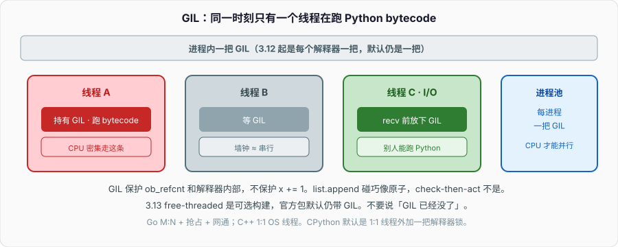
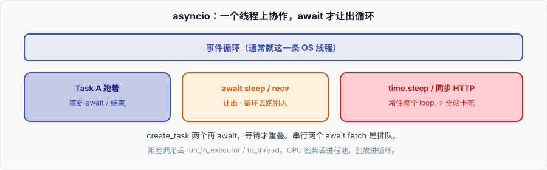

# 并发编程与GIL

同一份 CPU 密集的 checksum，`ThreadPoolExecutor` 开 8 个线程，墙钟几乎不降；换成 `ProcessPoolExecutor` 才降。本机数字会不同，数量级关系不会：

```python
import time
from concurrent.futures import ProcessPoolExecutor, ThreadPoolExecutor

N = 8
ITERS = 4_000_000


def checksum(seed: int) -> int:
    x = seed
    for _ in range(ITERS):          # 纯 Python 整数循环，持有 GIL
        x = (x * 1664525 + 1013904223) & 0xFFFFFFFF
    return x


def wall(pool_cls, workers: int = N) -> float:
    t0 = time.perf_counter()
    with pool_cls(max_workers=workers) as ex:
        list(ex.map(checksum, range(workers)))
    return time.perf_counter() - t0


if __name__ == "__main__":          # spawn 启动方式要求入口保护，见第六节
    serial = wall(ThreadPoolExecutor, 1)
    threaded = wall(ThreadPoolExecutor, N)
    proc = wall(ProcessPoolExecutor, N)
    print(f"serial   {serial:.3f}s")
    print(f"thread×{N} {threaded:.3f}s  speedup {serial / threaded:.2f}")
    print(f"proc×{N}   {proc:.3f}s  speedup {serial / proc:.2f}")
```

8 核机器上常见结果：`thread×8` 的加速比在 `0.9–1.1`，墙钟甚至比串行更差（调度 + 锁竞争）；`proc×8` 落在 `5–8`。不要拿 `hashlib` 当这个实验的负载——CPython 的 `hashlib` 对大块数据会在 C 层释放 GIL，测出来像「线程也能并行」，那是扩展自己放锁，不是解释器变了。

C++ 里 8 个 `std::thread` 跑同一段整数循环会接近线性；Go 里 8 个 goroutine 算 CPU 也会用满 GOMAXPROCS。Python 这条测量把差异钉死：bytecode 执行要过一把进程级的解释器锁。锁的名字叫 GIL。先把词分清，再进锁的内部。

---

## 一、并发 vs 并行，I/O 密集 vs CPU 密集

### 1、两个时间轴

并发（concurrency）：多件事在推进，时间轴上交错。一台单核机器上的 OS 线程切换是并发。并行（parallelism）：多件事在同一时刻真正执行，需要多个核。

```text
并发：  |--A--|  |--B--|  |--A--|  |--B--|     一个核切
并行：  |--------A--------|
        |--------B--------|                    两个核同时
```

C++ `std::thread` / Go goroutine 默认给你的心智是：把 CPU 活扔出去，墙钟按核数除。CPython 默认解释器不是这样。线程能并发推进 I/O；CPU 密集的 Python 字节码默认不能并行。

### 2、负载决定该不该并行

| 负载 | 卡在哪 | 多线程（默认 GIL） | 多进程 | asyncio |
| --- | --- | --- | --- | --- |
| 等 socket / 文件 / `sleep` | 内核，不跑 bytecode | 能叠等待，墙钟下降 | 能，但重 | 同线程叠等待，更轻 |
| 纯 Python 循环、解析、正则热路径 | 解释器 | 墙钟几乎不降 | 能降 | 更差（还占循环） |
| numpy / hashlib 大块、自释放 GIL 的 C 扩展 | C 层计算 | 可能降 | 能降 | 不该放进事件循环 |
| 混合：读网再算 | 两段都有 | 线程只加速 I/O 段 | 进程加速计算段 | I/O 段用 asyncio，计算丢 executor |

「我开了 8 个线程」什么都没证明。先问这段代码 90% 的时间在等 fd，还是在跑 `FOR_ITER`。

### 3、为什么 I/O 密集线程就有用

`socket.recv`、`time.sleep`、多数文件读，进内核前会把 GIL 放下。线程 A 阻塞在 `recv` 时，线程 B 可以拿到 GIL 跑 Python。8 个线程等 8 个慢 HTTP，墙钟接近最慢那个，不是 8 倍串行。把 `checksum` 换成 `time.sleep(0.2)`，同一套 `ThreadPoolExecutor` 加速比会接近 8——那测的是等待重叠，不是计算并行。

Go 把「等网」和「跑 CPU」都交给 runtime：goroutine 阻塞在 syscall 时，M 可以去跑别的 G。CPython 把「等网」做成释放 GIL，把「跑 CPU」做成持有 GIL。两个世界的分界就是这一把锁。

---

## 二、GIL 是什么

### 1、CPython 的解释器锁，不是语言的一部分

GIL（Global Interpreter Lock）是 **CPython** 里保护解释器内部状态的一把互斥锁。同一时刻，一个进程里默认只有一个线程在执行 Python bytecode。它保护的是：

- 每个 `PyObject` 的 `ob_refcnt` 增减
- 对象内部结构（list 的 `ob_item`、dict 的表、类型对象）
- 解释器全局状态（intern 表、模块 dict、GC 链表）

它不保护你的业务不变量。`x += 1` 照样丢更新，见第五节。

语言规范没有 GIL。Jython、IronPython 历史上就没有。PyPy 长期也有 GIL（STM 没成主流）。写 `python` 脚本时你碰到的是 CPython 的实现约束，面试里要把这句话说完：锁在实现上，不在语法上。

### 2、为什么当初要这把锁

CPython 对象模型是到处改引用计数。没有 GIL 时，每个 `Py_INCREF` / `Py_DECREF` 都要原子操作或细粒度锁；容器内部还要锁。90 年代的目标是让单线程足够快，并让 C 扩展写起来像在单线程里——`PyList_Append` 不用自己考虑别的 Python 线程。代价是多线程 CPU 打不开。

C++ 里这相当于：整个运行时一把 `std::mutex`，所有「碰对象图」的代码都得持有。没有人会给 C++ 标准库这么设计；CPython 是历史路径依赖加上「扩展生态已经按这个假设写了二十年」。



### 3、一个进程一把，还是一个解释器一把

3.12 之前：一个进程一把 GIL。3.12 的 PEP 684 给每个 sub-interpreter 独立的 GIL，隔离模块状态，用来做「进程内多解释器」。这不是取消 GIL，是把锁的粒度从进程收到解释器。默认你 `python app.py` 仍是一把锁。

3.13 另开一条线：free-threaded 构建（PEP 703），**可选**、**非默认**。第十节单独写。在那之前，所有「线程加速 CPU」的讨论都以「持有 GIL 的官方构建」为前提。

### 4、和 OS 锁的关系

GIL 是用户态互斥（内部是 condvar + mutex，带超时）。它不是内核的大内核锁，也不替代 `threading.Lock`。线程在跑 Python 时持有 GIL；进入阻塞 syscall 时释放。两个 Python 线程要协调业务数据，仍然要 `Lock` / `Queue`。GIL 保证的是解释器不把自己撕碎，不是 `dict` 里那个计数器按你的意图更新。

---

## 三、GIL 何时释放

### 1、三条路

1. **I/O / 阻塞调用**：`read`、`recv`、`connect`、`time.sleep`、多数 `os.wait*`。C 层用 `Py_BEGIN_ALLOW_THREADS` … `Py_END_ALLOW_THREADS` 包住 syscall。
2. **C 扩展主动放**：numpy 的大数组运算、部分 `hashlib`、压缩库，计算在 C 循环里、不碰 Python 对象时放下 GIL。这是「线程突然变快」的真正原因。
3. **时间片 / 协作检查点**：线程跑纯 Python 时也会定期把 GIL 让出去，让别的线程有机会跑。这是交错，不是并行。两个 CPU 密集线程来回抢锁，墙钟 ≈ 串行 + 切换开销。

### 2、3.2 之后是时间，不是 bytecode 计数

3.2 之前用 `sys.setcheckinterval(n)`：每 n 条 bytecode 检查一次是否该放 GIL。3.2 换成时间间隔：

```python
import sys

print(sys.getswitchinterval())     # 默认 0.005，五毫秒
sys.setswitchinterval(0.001)       # 切得更勤，开销更大，并行度不会因此出现
```

检查发生在 eval loop 的安全点。持有 GIL 的线程跑过一个间隔，发现有人在等（`gil_drop_request`），就放下。等待方被唤醒、抢到、继续。间隔调小只会让切换更碎，checksum 那种循环不会因此变快。

`setcheckinterval` 在 3.x 里还在，已经无意义。面试问「GIL 按多少条指令切换」，答：3.2 之后按时间，默认 5ms。

### 3、显式释放：给 C 扩展作者的 API

```c
Py_BEGIN_ALLOW_THREADS
/* 这里不能碰任何 PyObject，不能 INCREF/DECREF */
compute_in_c(buf, n);
Py_END_ALLOW_THREADS
```

规则是硬的：放锁期间碰 Python 对象就是数据竞争。numpy 能并行，是因为它在放锁前把 `PyArrayObject*` 需要的指针、stride、dtype 拿到栈上，计算只用 C 指针。你自己写的扩展如果在放锁期间 `PyList_GetItem`，bug 从「偶发」变成「必现」。

Python 层没有「我手动释放 GIL」的正规 API。`time.sleep(0)` 会放，但那是让出，不是「这段计算无锁并行」。想让纯 Python CPU 并行，换进程，或把热点下沉到会放锁的 C/Rust。

### 4、`sleep` 和忙等的差别

```python
import time
import threading

def busy() -> None:
    n = 0
    t0 = time.perf_counter()
    while time.perf_counter() - t0 < 0.2:
        n += 1                      # 一直持有 GIL

def sleepy() -> None:
    time.sleep(0.2)                 # 立刻释放 GIL
```

两个 `busy` 线程墙钟 ≈ 0.4s；两个 `sleepy` 线程墙钟 ≈ 0.2s。同一套 `Thread` API，负载不同，锁的行为不同。性能问题先看函数里有没有 syscall，再看有没有 C 循环。

---

## 四、threading：原语和线程池

### 1、`Thread` 本身

```python
import threading

def worker(name: str, n: int) -> None:
    print(f"{name} start {threading.current_thread().name}")
    total = sum(range(n))
    print(f"{name} {total}")


t = threading.Thread(target=worker, args=("w1", 1000), name="checksum-1")
t.start()
t.join()                            # 等结束；不 join 且非 daemon，进程退出会等它
print("joined", t.ident, t.native_id)
```

`target` 不能直接拿返回值。要结果，用 `Queue`，或直接上 `ThreadPoolExecutor`。`daemon=True` 的线程在主线程退出时被抛弃，`finally`、文件刷新都不保证。服务进程里工作线程不要 daemon，显式 `join` 或用线程池的 `shutdown(wait=True)`。

C++ `std::thread` 析构时如果仍 joinable 会 `std::terminate`；Python `Thread` 析构不 join，只是丢引用。Go 的 goroutine 没有 join 句柄，要用 `WaitGroup` / channel。Python 的 `Thread` 对象更像 C++ 的 `std::thread` 句柄，不像 goroutine。

### 2、`Lock` 和 `RLock`

```python
from threading import Lock, RLock, Thread

counter = 0
lock = Lock()


def add(n: int) -> None:
    global counter
    for _ in range(n):
        with lock:                  # acquire/release，异常也释放
            counter += 1


threads = [Thread(target=add, args=(100_000,)) for _ in range(4)]
for t in threads:
    t.start()
for t in threads:
    t.join()
print(counter)                      # 400000；拿掉 with lock，多半小于
```

`Lock` 不可重入：同一线程 `acquire` 两次，第二次死锁。`RLock` 记持有线程和重入计数，同一线程可嵌套。递归函数、持锁调本对象另一个也要锁的方法，用 `RLock`。代价是每次 acquire 多一次身份判断。默认用 `Lock`，需要重入再换。

`with lock` 用的是上下文管理器协议，上一篇写过。不要 `lock.acquire()` 之后靠函数返回来 `release`——中间 `return` / 异常会把锁带走。

### 3、`Condition`、`Event`、`Semaphore`

```python
from threading import Condition, Event, Semaphore, Thread
from collections import deque

# Event：一次性（可 clear）广播「发生了」
ready = Event()

def waiter() -> None:
    ready.wait(timeout=1.0)         # 超时返回 False，不抛
    print("go", ready.is_set())

# Condition：锁 + 等待队列。先持锁，wait 时放锁睡着，被 notify 后重新抢锁
buf: deque[int] = deque()
cv = Condition()


def producer() -> None:
    with cv:
        buf.append(1)
        cv.notify()                 # 只叫醒一个；全叫用 notify_all


def consumer() -> None:
    with cv:
        while not buf:              # 必须 while，不能 if：可能空唤醒
            cv.wait()
        print(buf.popleft())

# Semaphore：计数许可。BoundedSemaphore 在 release 超过初始值时抛
pool = Semaphore(3)                 # 最多 3 个并发进临界区
```

`Event.wait` 被 set 之后后来的 `wait` 立刻返回，直到 `clear`。拿它当「队列里有数据」会丢事件：set 的时候没人 wait、clear 之后数据还在。有数据用 `Queue` 或 `Condition`。

`Condition.wait` 必须在循环里谓词，和 C++ `std::condition_variable`、Go 的 `for !pred { cond.Wait() }` 同一条规则。虚假唤醒、notify 时谓词又变，都会让 `if not buf: cv.wait()` 醒来后看到空队列。

`Semaphore` 不像 Go 的 buffered channel 那样能带数据，只是许可。连接池「最多 N 条」用它；真正的对象交接仍要队列。

### 4、`queue.Queue`

```python
import queue
import threading

q: queue.Queue[int | None] = queue.Queue(maxsize=8)   # 有界，背压


def producer() -> None:
    for i in range(20):
        q.put(i)                    # 满则阻塞
    q.put(None)                     # 哨兵：结束


def consumer() -> None:
    while True:
        item = q.get()
        try:
            if item is None:
                q.put(None)         # 传给下一个消费者
                return
            ...
        finally:
            q.task_done()


workers = [threading.Thread(target=consumer) for _ in range(4)]
for t in workers:
    t.start()
producer()
q.join()                            # 等所有 task_done
for t in workers:
    t.join()
```

`Queue` 内部是 `deque` + `Lock` + 两个 `Condition`（未空 / 未满）。`put` / `get` 是线程安全的整段操作。自己用 `list.append` 当队列，没有 wait / notify，消费者只能忙等或漏唤醒。

`task_done` / `join` 跟踪的是「取出但未完成」的任务数，不是线程数。忘了 `task_done`，`q.join()` 永远等。有界 `maxsize` 是背压：生产者比消费者快时阻塞在 `put`，而不是内存涨到 OOM。

Go 的 channel 把队列、锁、等待、关闭收成一个类型。Python 的 `Queue` 没有 close。结束协议要自己定：哨兵、独立的 `Event`、或 `None`。多消费者时哨兵要回扔，或放 N 个哨兵。

### 5、`ThreadPoolExecutor`

```python
from concurrent.futures import ThreadPoolExecutor, as_completed

def fetch(i: int) -> int:
    return i * i


with ThreadPoolExecutor(max_workers=8, thread_name_prefix="io") as ex:
    futs = [ex.submit(fetch, i) for i in range(20)]
    for f in as_completed(futs):
        print(f.result())           # 异常在 result() 时重新抛
```

池子复用线程，避免每次 `Thread().start()` 的创建开销。`max_workers` 在 3.8+ 默认 `min(32, os.cpu_count()+4)`，对 I/O 往往偏小或偏大，要自己定。任务函数必须是纯参数进、返回值出；闭包抓可变列表是竞态。

`Future.result()` 会把工作线程里的异常在调用方重抛，带上工作线程的 traceback。不要在 `submit` 的函数里吞掉再返回 `None`，除非那是 API。

---

## 五、线程安全：GIL 不保证你的业务不变

### 1、原子的是 bytecode，不是语句

GIL 保证一条 bytecode 执行期间别的线程不跑 Python。`list.append` 在 CPython 里是一条（加少量）C 函数调用，持有 GIL 完成，看起来「原子」。`x += 1` 是 `LOAD_GLOBAL` / `LOAD_CONST` / `BINARY_OP` / `STORE_GLOBAL`，中间可以切换。

```python
import dis
import threading

x = 0


def bump() -> None:
    global x
    for _ in range(100_000):
        x += 1                      # 读-改-写，三步


ts = [threading.Thread(target=bump) for _ in range(4)]
for t in ts:
    t.start()
for t in ts:
    t.join()
print(x)                            # 经常 < 400000

dis.dis("x += 1")
```

`list.append(1)` 四个线程各 append 十万次，长度是四十万。`x += 1` 不是。`dict` 同理：`d[k] = v` 一次插入在 C 层完成，是原子的；`d[k] += 1` 是读出、加、写回，不是。

「CPython 里 append 原子」是实现细节，不是语言保证。PyPy、free-threaded 构建、自己给 list 加了钩子，都不一定成立。业务代码要共享可变状态，用锁或队列，不要赌 bytecode。

### 2、哪些操作可以当「单次、GIL 下原子」

经验上（CPython 3.11–3.13，**有 GIL 的官方构建**）：

| 操作 | 单次调用是否像原子 | 复合 |
| --- | --- | --- |
| `list.append` / `pop()` / `extend` 短序列 | 是 | `if not lst: lst.append` 不是 |
| `d[k]` 读、`d[k]=v`、`d.pop` | 是 | `d[k] += 1`、`setdefault` 后改 value 不是 |
| `set.add` / `discard` | 是 | 先 `in` 再 `add` 不是 |
| 内置 `int` / `float` 的 `+=` | 否 | — |
| 用户定义的 `__iadd__` | 否，还可能释放 GIL | — |
| 切片赋值 `a[i:j] = ...` | 一次 C 调用 | 自己循环赋不是 |

「像原子」只表示你不会看到 list 内部指针撕裂。不表示「先看再改」安全。check-then-act 一律加锁。

### 3、锁的粒度

```python
class Account:
    def __init__(self, n: int) -> None:
        self._n = n
        self._lk = Lock()

    def transfer(self, other: "Account", amt: int) -> None:
        with self._lk:
            with other._lk:         # 锁顺序：按 id 排，否则 AB-BA 死锁
                self._n -= amt
                other._n += amt
```

两个账户互转，按对象身份排序再加锁，是 C++ 里同一套手法。Python 没有 `std::scoped_lock` 那种一次性按地址排序的标准库锁，要自己写。更常见的做法是：**不要共享可变对象**，把变更收成消息丢进 `Queue`，单线程消费。Go 的口诀「不要通过共享内存通信」在这里同样适用；GIL 没有让共享内存变安全。

### 4、模块 import 和「看起来的单例」

CPython 3.3+ 对 import 有锁，同一个模块不会被两个线程同时执行到一半。这不表示模块级可变全局安全。两个线程 `cache[k] = compute(k)`，没有锁就会重复计算或写坏。`lru_cache` 在 3.9+ 命中路径有锁，未命中的 `user_function` 仍可能并发跑——函数必须可重入且无副作用交叉。

---

## 六、multiprocessing：进程、队列、共享内存

### 1、为什么墙钟终于降了

进程有各自的解释器和各自的 GIL。`checksum` 在子进程里跑，互不抢同一把锁。代价是：启动、内存、序列化。

```python
from multiprocessing import Process, Queue


def worker(seed: int, out: Queue) -> None:
    out.put(checksum(seed))         # 对象要能 pickle


if __name__ == "__main__":
    q: Queue[int] = Queue()
    ps = [Process(target=worker, args=(i, q)) for i in range(4)]
    for p in ps:
        p.start()
    print([q.get() for _ in ps])
    for p in ps:
        p.join()
```

C++ 里这是 `fork` + 共享内存或管道；Go 很少用多进程，默认就认为 goroutine 能吃满核。Python 把「并行 CPU」放到进程模型里，是被 GIL 逼出来的架构，不是因为进程比线程高级。

### 2、`fork` vs `spawn` vs `forkserver`

```python
import multiprocessing as mp

print(mp.get_start_method())        # macOS / Windows 默认 spawn；部分 Linux 仍 fork
mp.set_start_method("spawn")        # 只能设一次，要在创建进程之前
```

| 方法 | 做什么 | 坑 |
| --- | --- | --- |
| `fork` | 写时复制地址空间，子进程从 `fork` 点继续 | 父进程已有多线程时，锁在子进程里可能永远锁着；macOS 上客观存在崩溃 |
| `spawn` | 新解释器，重新 import 主模块，只跑 `if __name__ == "__main__"` 之外的顶层 | 启动慢；顶层代码会在子进程再跑一遍——所以必须入口保护 |
| `forkserver` | 先起一个无锁的 server 进程，之后从它 fork | Linux 上折中，启动比 spawn 快，比 fork 安全 |

macOS 从 3.8、Windows 一直，默认 `spawn`。Linux 3.14 起官方也在把默认往 spawn 推（具体以你装的版本为准），不要写死「Linux 就是 fork」。

`spawn` 下，子进程要 pickle `target` 和参数，然后 import 定义 `target` 的模块。模块顶层如果直接 `Process().start()`，子进程 import 时再 start，炸弹。`if __name__ == "__main__"` 不是仪式，是 spawn 的正确性条件。

Go 没有这套：没有 fork 出半个 runtime 的 API 作为常规路径。C++ 里 `fork` 后只准 async-signal-safe，和这里的「fork 时别有别的线程」是同一个内核事实。

### 3、`Queue`、`Pipe`、`Manager`

```python
from multiprocessing import Manager, Pipe, Queue

q: Queue[int] = Queue(maxsize=16)   # 底层 pipe + 后台 feeder 线程 + pickle
parent, child = Pipe()              # 双向或单向，传的也是 pickle 后的字节
parent.send({"n": 1})
print(child.recv())

with Manager() as mgr:
    d = mgr.dict()                  # 代理对象，操作变成 RPC 到 manager 进程
    d["k"] = 1
```

进程间 `Queue` 不是 `queue.Queue`。对象出进程必须 pickle。lambda、本地函数、定义在 `__main__` 里且 spawn 下找不到的类、持有锁 / 文件句柄的对象，都会在 `put` 时炸。

`Pipe` 更快、更薄，没有 `task_done`。同一端不要两个线程同时 `recv`。`Manager` 把共享 dict/list/Namespace 放到独立进程，方法调用都走序列化。方便，慢，不适合热路径。计数器用 `Value`，大块字节用共享内存。

### 4、共享内存

```python
from multiprocessing import Array, Value, Process
from multiprocessing import shared_memory

n = Value("i", 0)                   # ctypes，带锁（默认）
arr = Array("d", 1024)              # 连续 C 数组


def bump(v: Value) -> None:
    with v.get_lock():
        v.value += 1


if __name__ == "__main__":
    p = Process(target=bump, args=(n,))
    p.start(); p.join()
    print(n.value)

    shm = shared_memory.SharedMemory(create=True, size=1024)
    try:
        buf = shm.buf               # memoryview，零拷贝给 numpy
        buf[0] = 42
        # 子进程用 SharedMemory(name=shm.name) attach
    finally:
        shm.close()
        shm.unlink()
```

`Value` / `Array` 是一份 mmap 出来的 ctypes 对象，不经 pickle 传内容（句柄仍要传）。`Value("i")` 默认自带锁；`Value("i", 0, lock=False)` 就要自己保证。`shared_memory`（3.8+）适合 numpy 矩阵、大缓冲；生命周期要自己 `unlink`，父进程崩了可能留僵尸段。

C++ 程序员会觉得这才是「正常的共享内存」。是的，但它只适合 POD。Python 对象图不能直接放进去——对象头里有堆指针，别的进程地址空间对不上。想共享 `dict`，仍要 `Manager` 或自己设计字节协议。

### 5、pickle 限制，决定你能丢什么给子进程

```python
import pickle

def top() -> int:
    return 1

class Job:
    def __call__(self) -> int:
        return 2

# 行：顶层函数、顶层类、内置类型、多数第三方如果实现了 __reduce__
pickle.dumps(top)
pickle.dumps(Job())

# 不行：lambda、函数内部 def、局部类、generator、持有锁的对象
try:
    pickle.dumps(lambda: 1)
except pickle.PicklingError as e:
    print(type(e).__name__)
```

`ProcessPoolExecutor.map(lambda x: x+1, xs)` 在 spawn 下直接失败。把函数写到模块顶层。闭包捕获的大对象会整个序列化进子进程——不小心捕获了整个 `self`，就等于每条任务拷一份模型。

---

## 七、concurrent.futures：一套接口两套池

```python
from concurrent.futures import (
    ProcessPoolExecutor,
    ThreadPoolExecutor,
    as_completed,
    wait,
    FIRST_COMPLETED,
)

def cpu_job(n: int) -> int:
    return checksum(n)

def io_job(n: int) -> int:
    time.sleep(0.05)
    return n


def run(pool, fn, xs):
    with pool as ex:
        futs = {ex.submit(fn, x): x for x in xs}
        done, not_done = wait(futs, return_when=FIRST_COMPLETED)
        return [f.result() for f in as_completed(futs)]
```

`Executor.submit` → `Future`；`map` 保序。换池子只换构造器：I/O 用 `ThreadPoolExecutor`，CPU 用 `ProcessPoolExecutor`。异常、超时、取消的语义同一套：

- `f.result(timeout=1)`：超时抛 `TimeoutError`，任务还在跑
- `f.cancel()`：只取消尚未开始的；已经在跑的线程/进程收不回来
- `shutdown(wait=True, cancel_futures=True)`（3.9+）把队列里没开始的丢掉

进程池的 `Future` 仍要 pickle 返回值。返回一个 2GB 的 list，主进程会卡在反序列化上，加速比被吃光。返回摘要、路径、共享内存名，不要返回整个矩阵。

面试里「`concurrent.futures` 和 `multiprocessing.Pool` 怎么选」：新代码用 futures，API 小、能和 asyncio 的 `loop.run_in_executor` 对上。`Pool` 的 `imap_unordered`、`maxtasksperchild`（防泄漏）在进程池仍有用，`ProcessPoolExecutor` 3.11+ 也有 `max_tasks_per_child`。

---

## 八、asyncio：单线程协作

### 1、事件循环、coroutine、Task

```python
import asyncio

async def fetch(i: int) -> int:
    await asyncio.sleep(0.05)       # 让出循环；不是 time.sleep
    return i


async def main() -> None:
    t1 = asyncio.create_task(fetch(1))
    t2 = asyncio.create_task(fetch(2))
    print(await t1 + await t2)


asyncio.run(main())
```

`async def` 返回 coroutine 对象，不跑。`await` 把它交给事件循环。循环在当前线程里轮询就绪的 I/O，恢复对应 coroutine。同一时刻只有一个 coroutine 在跑 Python——仍然受 GIL 管，而且通常根本没有第二个 Python 线程。

`create_task` 把 coroutine 调度成 `Task`（`Future` 的子类）。只 `await fetch(1)` 再 `await fetch(2)` 是串行；先 `create_task` 两个再 `await`，等待才重叠。



3.11 的 `TaskGroup` 把「一组任务、一个失败全取消」收成结构化并发：

```python
async def main() -> None:
    async with asyncio.TaskGroup() as tg:
        t1 = tg.create_task(fetch(1))
        t2 = tg.create_task(fetch(2))
    print(t1.result(), t2.result())  # 离开 with 时都结束；失败是 ExceptionGroup
```

### 2、`gather`、`wait`、超时

```python
async def batch(xs: list[int]) -> None:
    # gather：等全部；return_exceptions=True 时异常当返回值
    rs = await asyncio.gather(*(fetch(x) for x in xs), return_exceptions=True)

    tasks = [asyncio.create_task(fetch(x)) for x in xs]
    done, pending = await asyncio.wait(tasks, timeout=0.1)
    for t in pending:
        t.cancel()
    # wait 不取消 pending，要自己 cancel；cancel 在下次 await 抛 CancelledError

    try:
        await asyncio.wait_for(fetch(9), timeout=0.01)
    except TimeoutError:            # 3.11+ 内置 TimeoutError；3.10 是 asyncio.TimeoutError，已是别名
        pass
```

`gather` 一个失败默认取消其余（3.x 行为，`return_exceptions` 除外）。`wait` 更底层，只分类 done/pending。超时用 `wait_for` 或 3.11 的 `asyncio.timeout`：

```python
async def bounded() -> None:
    async with asyncio.timeout(0.2):
        await fetch(1)
```

### 3、`Semaphore` 和 `Queue`

```python
async def crawl(urls: list[str]) -> None:
    sem = asyncio.Semaphore(20)     # 并发度，不是线程数
    q: asyncio.Queue[str | None] = asyncio.Queue(maxsize=100)

    async def worker() -> None:
        while True:
            u = await q.get()
            try:
                if u is None:
                    return
                async with sem:
                    await fetch(hash(u) & 0xFFFF)
            finally:
                q.task_done()

    workers = [asyncio.create_task(worker()) for _ in range(8)]
    for u in urls:
        await q.put(u)
    await q.join()
    for _ in workers:
        await q.put(None)
    await asyncio.gather(*workers)
```

`asyncio.Semaphore` / `Queue` 不是线程安全的，不要从旁路线程去 `put`。跨线程用 `loop.call_soon_threadsafe`，或把线程结果丢给 `run_in_executor` 的 Future。有界队列同样是背压：爬虫生产 URL 的速度必须被消费卡住，否则 Queue 把内存吃光。

### 4、什么时候该用，什么时候不该

该用：

- 成千上万的 socket / HTTP / 长连接，每个连接大部分时间在等
- 协议状态机、代理、聊天、爬虫、网关
- 已经是 async 的库（`aiohttp`、`httpx.AsyncClient`、async DB driver）

不该用：

- CPU 密集（解析大 JSON、图像、加解密的纯 Python 热循环）——会堵住整条循环，所有连接一起卡
- 底层库是同步阻塞且你不包 executor：`requests.get`、同步 Redis、`time.sleep`、CPU 的 `checksum`
- 只是「看起来异步」：在 `async def` 里调 `requests`，协程在等网时占着循环，并发度掉成 1

生成器那一篇停在「`send` 不是 asyncio」。这里补一句：`async def` 的协程和生成器帧类似，都是冻住的栈；调度器不同。生成器要人拉 `next`；asyncio 的循环根据 fd 就绪来 `await` 恢复。不要在 `async def` 里同步 `for` 一个会阻塞的生成器还指望能并发。

Go 的 goroutine 在 syscall 上会把 M 让出来，CPU 密集也会被调度器抢占（1.14 之后异步抢占）。asyncio **不会**在两条 Python 语句之间被抢占，只在 `await` 点让出。漏一个 `await`、或者 `await` 到的是已经算完的 CPU 函数，循环就冻死。这是协作，不是抢占。

---

## 九、在 asyncio 里跑阻塞调用：`run_in_executor`

```python
import asyncio
from concurrent.futures import ProcessPoolExecutor

def blocking_read(path: str) -> bytes:
    with open(path, "rb") as f:     # 同步 I/O
        return f.read()


async def handle(path: str) -> int:
    loop = asyncio.get_running_loop()
    data = await loop.run_in_executor(None, blocking_read, path)
    # None = 默认 ThreadPoolExecutor，适合阻塞 I/O
    return len(data)


async def handle_cpu(seed: int) -> int:
    loop = asyncio.get_running_loop()
    with ProcessPoolExecutor() as pool:          # 演示用；生产里池子要长活
        return await loop.run_in_executor(pool, checksum, seed)
```

`run_in_executor` 把调用丢到别的线程/进程，当前协程在 Future 上挂起，循环去跑别人。默认线程池有上限（3.8+ 和 `ThreadPoolExecutor` 默认一样），突然来一万个阻塞请求会把池填满，后续 `run_in_executor` 排队——事件循环没死，吞吐掉了。生产里自己建池，I/O 一个、CPU 一个，关掉默认那个的隐式共享。

`time.sleep`、`requests`、同步 boto3，进了 `async def` 就必须走这条路，或者换 async 库。包一层 `async def` 但不 `await` 到非阻塞点，是假异步。

3.9+ 也可以 `asyncio.to_thread(blocking_read, path)`，语义等于 `run_in_executor(None, ...)`，签名更好看。CPU 仍要进程池。

---

## 十、3.13 free-threaded（PEP 703）

### 1、可选构建，不是「GIL 已经没了」

3.13 提供 **free-threaded** 构建：编译时 `--disable-gil`，解释器可在无 GIL 模式下跑多线程并行 Python bytecode。官方安装包、各 Linux 发行版默认的 `python3.13` **仍然带 GIL**。带 `t` 后缀的才是（例如 `python3.13t`，wheel 标签 `cp313t`）。

```python
import sys

print(sys.version)
# 3.13.x free-threaded 构建上：
print(getattr(sys, "_is_gil_enabled", lambda: True)())
```

同一份 free-threaded 二进制还可以把 GIL 再打开：`PYTHON_GIL=1` 或 `-X gil=1`。反过来，带 GIL 的官方构建不能靠环境变量关掉锁。面试问「3.13 是不是没 GIL 了」，答：默认有；无 GIL 是另一条 ABI，要专门的构建和专门的轮子。

### 2、扩展要适配

没有 GIL 之后，`Py_INCREF` 不再天然单线程。C 扩展如果：

- 把 GIL 当「不会有别的线程碰我的 C 静态变量」
- 在未持有任何锁时改模块级 C 状态
- 用了未声明 thread-safe 的 API

就会在 free-threaded 下数据竞争。numpy、cffi、大量老轮子在 3.13 初期只能在带 GIL 的解释器上装。`cp313` 和 `cp313t` 是两套 wheel，不能混。

Python 层自己写的 `list.append` / `d[k] += 1` 竞态，在 free-threaded 下从「偶发错计数」变成「可能撕对象」。GIL 曾经给过的那层「单条 C API 看起来原子」，不再成立。要并行吃满核，先把共享可变状态清掉。

### 3、性能账

free-threaded 构建单线程会慢一截（引用计数变成更贵的原子/偏置方案，对象头变大，特化优化还在追）。多线程 CPU 密集才有机会超过带 GIL 的单线程。不是免费午餐：用 8 核换回单核损失，还要扩展生态跟上。

3.13 这份还带「实验性」标签；3.14 在推稳定度，默认官方包仍然是带 GIL 的那条线。写生产代码：默认按有 GIL 设计；要用 free-threaded，当成单独的部署产物，CI 双跑，扩展白名单。

### 4、面试怎么答

1. GIL 是 CPython 实现细节，保护引用计数和解释器状态，不是语言规范。
2. 默认构建（含 3.13 官方包）仍有 GIL：多线程加速 I/O，不加速纯 Python CPU。
3. 3.13 起可以编一份 free-threaded，PEP 703；要另装、另编扩展，ABI 不兼容。
4. 不要说「GIL 已经没了」。问并行就答：I/O 用线程或 asyncio，CPU 用多进程或下沉 C/Rust；free-threaded 是未来选项，不是当前默认。
5. 就算没有 GIL，`x += 1` 仍然要锁或原子。GIL 从未免除业务锁。

---

## 十一、选型

| 场景 | 选 | 为什么 |
| --- | --- | --- |
| 大量 socket / HTTP，库是 async | asyncio | 单线程叠等待，内存比线程小一个数量级 |
| 大量 I/O，库是同步阻塞 | `ThreadPoolExecutor` | 阻塞时放 GIL，实现简单 |
| 纯 Python CPU（解析、规则、热循环） | `ProcessPoolExecutor` | 多把 GIL，真并行 |
| numpy / 自放 GIL 的 C 扩展 CPU | 线程或进程都可 | 先测；线程更轻，扩展真放锁才有效 |
| 热点小、调用极密 | 下沉 C / Rust / Cython，并在 C 层 `ALLOW_THREADS` | 进程 pickle 太贵 |
| 要共享大矩阵 | 进程 + `shared_memory` | 别 pickle 2GB |
| 共享可变业务状态 | 不要共享；`Queue` 消息化 | GIL / free-threaded 都救不了 check-then-act |
| 8 个独立 CPU 任务、结果很小 | 进程池 | 开篇那条测量 |
| 事件循环里突然要读磁盘 / 算 checksum | `to_thread` / 进程池 `run_in_executor` | 别堵住 loop |

混合服务常见形状：边缘 asyncio 收连接，CPU 丢进程池，同步 SDK 丢线程池。三套池的 `max_workers` 分开配，队列有界。不要一个默认线程池扛所有 `run_in_executor`。

---

## 十二、和 Go goroutine、C++ thread 的调度模型

| | C++ `std::thread` | Go goroutine | CPython 线程 + GIL | CPython asyncio |
| --- | --- | --- | --- | --- |
| 映射 | 1:1 OS 线程 | M:N，G 跑在 M 上 | 1:1 OS 线程，外加一把解释器锁 | 1 个 OS 线程上的协作任务 |
| CPU 并行 | 是 | 是（GOMAXPROCS） | 默认否；free-threaded 才可能 | 否 |
| I/O | 自己 epoll 或阻塞 | runtime 网通轮询，G 阻塞不绑死 M | 阻塞调用放 GIL | 循环自己 poll，`await` 让出 |
| 抢占 | OS 抢占 | 1.14 起异步抢占（信号 / 函数入口） | OS 抢占线程，但下一线程仍要抢 GIL | **无**。只在 `await` 让出 |
| 通信 | mutex / condvar / lock-free | channel | `Queue` / `Lock` | `asyncio.Queue`，单线程 |
| 栈 | 大，MB 级 | 小，可增长 | 和 C++ 一样大 | 协程帧很小（类似生成器） |
| 取消 | 自己做 | `context` | 没有标准取消；Future.cancel 弱 | `Task.cancel` / TaskGroup / timeout |

Go 把调度、网通、抢占收进 runtime：你写 `go f()`，CPU 和 I/O 都像能并行（I/O 其实是并发，CPU 是并行）。C++ 把线程当内核资源，调度器是 OS，I/O 模型你自己选。CPython 拆成三截：

- 解释器锁决定 **Python bytecode 能不能并行**
- `threading` 把 OS 线程暴露出来，I/O 时放锁
- `asyncio` 在一条线程里做协作式网通轮询，**没有** Go 那种抢占，也 **没有** 把阻塞 syscall 自动挪到别的 M 上——除非你自己 `run_in_executor`

所以从 Go 迁过来最常见的两个事故：

1. 以为 `async def` 里调 `requests` 就等于 `http.Get`——Go 的 `http.Get` 会把 G 从 M 上卸下来；`requests` 会把事件循环冻住。
2. 以为开 8 个 `Thread` 就能让 checksum 变 8 倍——Go 里 8 个 G 会；CPython 默认不会。

从 C++ 迁过来的事故是另一种：把 `std::thread` + `std::mutex` 的心智原样搬到 Python，忽略 GIL 已经把 CPU 串行化，于是既没并行，还自己加一把业务锁，两层串行。CPU 活进程化或下沉；I/O 活看库是不是 async。锁留给真正的共享不变量，不要用来「希望变快」。
